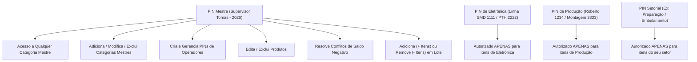

# 📘 Manual de Uso do Sistema — Estoque Luxpryme

**Versão do Sistema:** 1.2.0  
**Data da Edição:** Novembro / 2026  
**Empresa:** Luxpryme Indústria Eletrônica  
**Ambientes Suportados:** Windows 10/11 (Desktop) e Android 7.0+ (Celulares e Coletores)

---

## 📑 Sumário

1. [Visão Geral do Sistema](#1-visão-geral-do-sistema)
2. [Arquitetura de Categorias Mestres](#2-arquitetura-de-categorias-mestres)
3. [Controle de Acesso e Hierarquia de PINs](#3-controle-de-acesso-e-hierarquia-de-pins)
4. [Interface do Usuário: Desktop vs Versão Mobile Redesenhada](#4-interface-do-usuário-desktop-vs-versão-mobile-redesenhada)
5. [Como Navegar, Buscar Produtos e Filtrar](#5-como-navegar-buscar-produtos-e-filtrar)
6. [Gestão em Lote de Categorias Mestres (+ Itens e - Itens)](#6-gestão-em-lote-de-categorias-mestres--itens-e---itens)
7. [Movimentação de Estoque, Carrinho com Observação e Baixa com PIN](#7-movimentação-de-estoque-carrinho-com-observação-e-baixa-com-pin)
8. [Cadastro e Edição de Produtos](#8-cadastro-e-edição-de-produtos)
9. [Gerenciamento de Categorias Mestres Dinâmicas](#9-gerenciamento-de-categorias-mestres-dinâmicas)
10. [Painel do Administrador (Exclusivo Windows)](#10-painel-do-administrador-exclusivo-windows)
11. [Operação 100% Offline-First e Sincronização em Segundo Plano](#11-operação-100-offline-first-e-sincronização-em-segundo-plano)
12. [Detecção e Resolução de Conflitos de Estoque (Saldo Negativo)](#12-detecção-e-resolução-de-conflitos-de-estoque-saldo-negativo)
13. [Histórico, Rastreabilidade e Exportação de Relatórios](#13-histórico-rastreabilidade-e-exportação-de-relatórios)
14. [Instalação em Novos Computadores e Celulares](#14-instalação-em-novos-computadores-e-celulares)
15. [Perguntas Frequentes e Solução de Problemas](#15-perguntas-frequentes-e-solução-de-problemas)

---

## 1. Visão Geral do Sistema

O **Estoque Luxpryme** é o software oficial de controle de estoque industrial da Luxpryme, desenvolvido para suportar desde laboratórios eletrônicos de precisão até linhas automatizadas de montagem SMD, soldagem PTH, montagem de luminárias e almoxarifado fabril.

### Principais Destaques da Versão:
* **Catálogo Completo em Alta Performance:** Carregamento fluido de todo o catálogo industrial (> 5.420 produtos cadastrados).
* **Tecnologia Offline-First com Cache em Disco:** O sistema baixa todo o catálogo uma única vez. Ao reabrir o app, o carregamento é instantâneo (**0 segundos de espera**), funcionando perfeitamente sem internet ou com sinal instável.
* **Sincronização em Segundo Plano:** Assim que houver conexão, as alterações feitas offline são enviadas automaticamente para a nuvem via Supabase.
* **Detecção Automática de Conflitos:** Se dispositivos desconectados retirarem produtos simultaneamente e o saldo ficar negativo, o sistema alerta e disponibiliza opções imediatas para regularizar o estoque.
* **Separação por Categorias Mestres:** Organização clara entre *Eletrônica*, *Produção*, *Outros* e setores customizados.
* **Rastreabilidade e Segurança com PIN de 4 Dígitos:** Toda separação de peças exige o PIN do operador, garantindo auditoria completa com registro opcional de observação técnica.

---

## 2. Arquitetura de Categorias Mestres

Para organizar estoques de grande porte e segmentar as responsabilidades por setor da fábrica, o sistema adota as **Categorias Mestres**.

### As Categorias Mestres Padrão:

| Categoria Mestre | Cor Visual | Descrição e Finalidade |
| :--- | :--- | :--- |
| **Eletrônica** | 🔵 Azul | Componentes SMD, componentes PTH, circuitos integrados, PCBs virgens e placas montadas/testadas. Setor exclusivo do laboratório eletrônico. |
| **Produção** | 🟢 Verde | Componentes mecânicos, carcaças plásticas, lentes, parafusos, baterias, chicotes e insumos usados na montagem do produto final de iluminação. |
| **Outros** | ⚪ Cinza Slate | Insumos gerais de fábrica, manutenção predial, hidráulica, civil, limpeza e ferramentas de apoio. |

### Compartilhamento entre Categorias:
Um produto pode pertencer a **mais de uma Categoria Mestre** ao mesmo tempo.  
*Exemplo:* Uma bateria industrial ou chicote elétrico soldado na bancada de eletrônica e também utilizado na linha de montagem pode ter marcadas as categorias **Eletrônica** e **Produção**. Operadores de ambos os setores poderão requisitá-lo.

---

## 3. Controle de Acesso e Hierarquia de PINs

O sistema protege o estoque definindo alçadas de autorização através de PINs numéricos de 4 dígitos:

### Regras de Permissão:
1. **PIN Mestre (Todas as Categorias):**
   - Autorização irrestrita para retirar ou depositar qualquer item do catálogo.
   - É o **único** autorizado a adicionar, modificar ou excluir Categorias Mestres, resolver conflitos de saldo negativo e usar as funções de lote `+ Itens` e `- Itens`.
2. **PIN Setorial (Eletrônica / Produção / Personalizado):**
   - Autorizado a movimentar apenas itens vinculados à sua Categoria Mestre.
   - Caso tente finalizar um carrinho contendo itens de outro setor, a requisição é bloqueada por segurança.

---

## 4. Interface do Usuário: Desktop vs Versão Mobile Redesenhada

O aplicativo foi otimizado para proporcionar a melhor ergonomia tanto em monitores de alta resolução quanto em celulares:

### Versão Celular (Mobile):
* **Menu Superior Limpo:** Logotipo oficial da Luxpryme, ícone de Lupa de busca expansível, Carrinho de Separação com contador vermelho, Histórico de Movimentações, Botão de Sincronizar e Botão de Logout.
* **Barra de Categorias Mestres Compacta:** Ocupa espaço reduzido na tela com chips horizontais e botão de ordenação rápida integrado à direita.
* **Acesso às Categorias Comuns no Mobile:** Para visualizar as categorias técnicas comuns (ex: *Componentes SMD*, *Baterias*, etc.), basta **manter pressionado (toque longo / long press)** o chip da categoria mestre em que você se encontra.
* **Menu de Ações Flutuante (Canto Inferior Direito):** Um botão redondo abre uma lista suspensa com todas as ferramentas essenciais:
  - `+ Itens` (Adicionar múltiplos produtos à categoria mestre).
  - `- Itens` (Remover múltiplos produtos de uma categoria mestre).
  - `Novo Item` (Cadastrar produto com PIN).
  - `Gerenciar Categorias Comuns`.
  - `Gerenciar Categorias Mestres` (com PIN Mestre).
  - `Modo Biblioteca` (Visão estruturada em árvore).

### Versão Computador (Desktop Windows):
* Exibe a barra de busca ampla central, atalhos de administração no cabeçalho e menu flutuante inferior para operações rápidas em lote (`+ Itens` e `- Itens`).

---

## 5. Como Navegar, Buscar Produtos e Filtrar

### 5.1. Busca Inteligente por Palavras Desordenadas
A busca quebra o texto em termos independentes. Não é necessário digitar o nome na ordem exata:
* Digitando `farol placa 16` o sistema encontra `MONTAGEM PLACA ELETRONICA FAROL 16 LEDS`.
* Digitando o **Código Interno** (ex: `6857`) ou o **Part Number** do fabricante, o item é localizado imediatamente.

### 5.2. Filtro Rápido por Categorias Mestres
Na barra horizontal colorida:
* **Todas:** Catálogo completo.
* **Eletrônica:** Apenas componentes de laboratório e placas.
* **Produção:** Apenas insumos e materiais de montagem final.
* **Outros:** Almoxarifado geral e manutenção.

### 5.3. Ordenação Dinâmica
Ao clicar no ícone de ordenar (ou no menu suspenso), escolha entre:
* **Nome (A - Z)** / **Nome (Z - A)**
* **Menor Estoque** (destaca itens esgotados ou críticos) / **Maior Estoque**
* **Último Modificado** (destaca peças recém-movimentadas)

---

## 6. Gestão em Lote de Categorias Mestres (+ Itens e - Itens)

Disponível no menu flutuante inferior direito, essa ferramenta permite reclassificar rapidamente centenas de itens sem precisar abrir produto por produto.

### 6.1. Adicionar em Lote (+ Itens)
1. Abra o menu inferior direito e clique em **+ Itens**.
2. Selecione a **Categoria Mestre de Destino** (ex: *Produção*).
3. **Filtro Inteligente:** O sistema exibe apenas os produtos que **ainda não pertencem** a essa categoria mestre.
4. Digite o nome ou código no campo de busca.
5. Toque/clique nos itens desejados para selecioná-los:
   - Um contador em **círculo azul** com número branco surge à direita informando a quantidade de itens marcados.
   - O campo de busca **limpa automaticamente o texto** e mantém o cursor pronto para você pesquisar o próximo item sem perder tempo apagando letras.
6. Clique em **Adicionar Selecionados à Categoria**.
7. Digite o **PIN Mestre (2026)** para autenticar a alteração.

### 6.2. Remover em Lote (- Itens)
1. Abra o menu inferior direito e clique em **- Itens**.
2. Selecione a Categoria Mestre da qual deseja desvincular itens.
3. **Filtro Exclusivo:** O sistema exibe **apenas os produtos que já pertencem** a essa categoria mestre.
4. Selecione os produtos a remover.
5. Clique em **Remover Selecionados da Categoria** e autentique com o **PIN Mestre**.  
   *(Se um produto ficar sem nenhuma categoria mestre, ele é transferido automaticamente para "Outros" por segurança).*

---

## 7. Movimentação de Estoque, Carrinho com Observação e Baixa com PIN

O sistema oferece dois modos de movimentação de saldo:

### Modo A: Ajuste Unitário Instantâneo (+1 / -1)
* **Finalidade:** Pequenas baixas ou reposições de 1 unidade em bancada.
* **Como fazer:** No card do produto, toque nos botões `+` ou `-`. O saldo atualiza imediatamente no aparelho e salva no histórico.

### Modo B: Carrinho de Separação (Requisições em Lote e Ordem de Produção)
* **Finalidade:** Separação de kits de componentes para ordens de serviço ou entrada de remessas de fornecedores.
* **Passo a Passo:**
  1. No card do produto, toque no botão **Pegar / Movimentar**.
  2. Defina a quantidade e escolha **Saída (Retirada)** ou **Entrada (Depósito)**.
  3. Adicione todos os componentes necessários à lista de separação.
  4. Abra o **Carrinho** tocando no ícone do carrinho no topo da tela.
  5. **Observação Opcional da Requisição:** No campo de texto antes da finalização, você pode digitar uma anotação (ex: *"Linha 2 - Ordem de Produção #840"* ou *"Bancada de Testes PTH"*).
  6. Toque em **Finalizar com PIN**.
  7. Digite o **PIN de 4 dígitos** do operador.
  8. O sistema valida as permissões e abate/adiciona o saldo de todos os itens simultaneamente, registrando a observação no histórico de auditoria.

---

## 8. Cadastro e Edição de Produtos

### 8.1. Cadastrar um Novo Item
1. No menu inferior direito, clique em **Novo Item**.
2. Preencha as informações:
   - **Nome do Produto** (Obrigatório).
   - **Código Interno / P/N Fabricante / Código de Barras**.
   - **Categorias Mestres:** Marque os setores autorizados (*Eletrônica*, *Produção*, *Outros*, etc.).
   - **Categoria Técnica Comum e Sub-categorias**.
   - **Estoque Inicial e Estoque Mínimo de Alerta**.
   - **Localização:** Ex: *Gaveteiro A3, Prateleira 2*.
3. Digite um **PIN de Operador** autorizado para o setor do item.
4. Clique em **Salvar Produto**.

### 8.2. Editar ou Excluir Produto
* No menu de opções do card (`...`), clique em **Editar**.
* Para excluir, clique em **Excluir Produto** e confirme com o **PIN autorizado** correspondente ao setor.

---

## 9. Gerenciamento de Categorias Mestres Dinâmicas

Com o **PIN Mestre** (ex: `2026`), é possível cadastrar novos setores da fábrica sem precisar de suporte técnico.

### Como Cadastrar um Novo Setor:
1. No menu inferior direito (ou painel admin), clique em **Gerenciar Categorias Mestres**.
2. Clique em **+ Nova Categoria Mestre**.
3. Preencha:
   - **Nome do Setor** (ex: *Preparação*, *Embalamento*, *Corte de Cabos*).
   - Descrição breve.
   - Cor de identificação visual e ícone representativo.
4. Digite o **PIN Mestre (4 dígitos)** e confirme.
5. O novo setor surge imediatamente nas abas, filtros e telas de cadastro de PINs.

---

## 10. Painel do Administrador (Exclusivo Windows)

Disponível no computador para o usuário administrador autenticado (`tomibr20@gmail.com`).

### Funcionalidades:
* **Cadastro de PINs de Operadores:**
  1. Digite o nome do operador ou bancada (ex: *Bancada Solda PTH 2*).
  2. Digite o PIN numérico exclusivo de 4 dígitos.
  3. Selecione a alçada: **Mestre (Todas as Categorias)** ou **Setorial** (*Eletrônica*, *Produção*, *Preparação*, etc.).
  4. Clique em **Cadastrar PIN**.
* **Revogação Instantânea:** Toque no ícone de lixeira ao lado de qualquer operador para revogar o PIN imediatamente.

---

## 11. Operação 100% Offline-First e Sincronização em Segundo Plano

O **Estoque Luxpryme** foi construído com arquitetura de alta disponibilidade para suportar fábricas com galpões distantes ou oscilação de Wi-Fi:

### Como Funciona:
1. **Cache Persistente no Aparelho:** Todo o inventário (> 5.420 produtos) fica gravado na memória interna do celular ou computador.
2. **Abertura em 0ms:** O aplicativo não fica travado em telas de carregamento. Você abre e o catálogo já está pronto para uso.
3. **Trabalho Sem Internet:**
   - Você pode fazer baixas no carrinho, ajustes rápidos (+1/-1), cadastrar itens ou mexer em categorias normalmente sem conexão.
   - Cada ação é gravada no banco local e armazenada na **Fila de Sincronização Pendente** (`pending_sync_queue.json`).
4. **Sincronização Automática em Segundo Plano:**
   - Ao detectar conexão com a internet, o sistema descarrega a fila silenciosamente para a nuvem.
   - Não interfere no trabalho do operador.

---

## 12. Detecção e Resolução de Conflitos de Estoque (Saldo Negativo)

### O que é o Conflito de Sincronização?
Se dois dispositivos estiverem operando offline e ambos realizarem a retirada de peças de um mesmo componente que estava com poucas unidades, no momento em que ambos se conectarem à internet o saldo calculado pode ficar negativo (ex: `-3 un`).

### Como o Sistema Notifica:
Um banner de aviso destacado é exibido no topo da tela inicial:
> ⚠️ **Conflito de Estoque: X item(ns) com saldo negativo**  
> *Retiradas simultâneas geraram déficit. Clique para corrigir. [Resolver]*

### Opções de Correção no Diálogo de Conflitos:
Ao clicar em **Resolver**, o gestor tem 4 alternativas para cada item:
1. **Zerar Saldo (0 un):** Redefine o estoque do produto para zero com PIN Mestre e grava um registro de auditoria no histórico.
2. **Informar Saldo Real em Almoxarifado:** Abre um campo para o operador contar fisicamente quantas peças restam na gaveta e atualizar o saldo real com PIN Mestre.
3. **Estornar Déficit:** Reverte o número negativo adicionando a quantidade faltante (ex: se o saldo era `-4 un`, adiciona `+4 un` trazendo a `0 un`).
4. **Dispensar:** Oculta a notificação caso já tenha sido corrigida externamente.

---

## 13. Histórico, Rastreabilidade e Exportação de Relatórios

Para auditar o fluxo de materiais da fábrica:
1. Clique no ícone de **Histórico & Relatórios** no menu superior.
2. Consulte os detalhes de cada registro:
   - Data e hora exatas.
   - Nome do componente, código interno e part number.
   - Tipo de operação: *Carrinho*, *Ajuste Unitário (+1/-1)* ou *Resolução de Conflito*.
   - Saldo anterior e novo saldo resultante.
   - Nome do operador e identificação do PIN.
   - **Observação / Ordem de Produção** anotada no carrinho.
3. **Exportar Relatório:** Clique em **Gerar Relatório** para salvar uma planilha CSV compatível com Excel e Google Sheets.

---

## 14. Instalação em Novos Computadores e Celulares

### No Computador (Windows):
1. Copie o arquivo `LuxprymeStock-Windows.zip` para o computador.
2. Clique com o botão direito e selecione **Extrair Tudo**.
3. Abra a pasta extraída e execute `luxpryme_stock.exe`.
4. *Dica:* Crie um atalho na Área de Trabalho para iniciar o sistema diariamente.

### No Celular (Android):
1. Envie o arquivo `app-release.apk` para o celular (via WhatsApp, Google Drive ou cabo USB).
2. Toque no arquivo APK para iniciar a instalação.
3. Permita "Instalar aplicativos de fontes desconhecidas" caso solicitado pelo Android.
4. Abra o **Estoque Luxpryme**. O catálogo e o cache serão configurados automaticamente.

---

## 15. Perguntas Frequentes e Solução de Problemas

### 1. "O aplicativo funciona se eu desligar o Wi-Fi ou ligar o modo avião?"
**Sim.** O sistema possui tecnologia Offline-First. Todas as movimentações continuam funcionando normalmente e serão sincronizadas assim que a conexão retornar.

### 2. "Como vejo as subcategorias no celular se a barra não aparece?"
No celular, a barra foi condensada para economizar espaço de tela. **Mantenha o dedo pressionado (toque longo)** sobre o botão da Categoria Mestre desejada para abrir a gaveta com todas as categorias comuns e subcategorias técnicas.

### 3. "Como adicionar vários itens de uma vez para uma categoria mestre?"
Abra o menu circular no canto inferior direito e toque em **+ Itens**. Selecione a categoria mestre de destino e pesquise os itens. Ao tocar em cada um, o sistema conta no círculo azul e limpa a busca automaticamente para agilizar.

### 4. "Por que meu PIN de operador foi rejeitado no carrinho?"
Verifique as categorias mestres dos itens selecionados. Um PIN setorial (ex: Eletrônica) só pode movimentar itens de sua área. Para movimentar itens mistos, utilize o PIN de cada setor ou o PIN Mestre do supervisor (`2026`).

### 5. "O que significa o banner de alerta de conflito de estoque?"
Significa que dois operadores deram baixa em um mesmo componente em aparelhos desconectados, fazendo o saldo daquele item ficar abaixo de zero ao sincronizar. Basta clicar em **Resolver** e escolher zerar ou digitar a contagem real física.

---

*Estoque Luxpryme — Controle de Estoque Industrial de Alta Precisão.*
