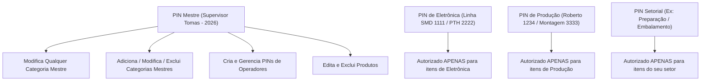

# 📘 Manual de Uso do Sistema — Estoque Luxpryme

**Versão do Sistema:** 1.0.0  
**Data da Edição:** Novembro / 2026  
**Empresa:** Luxpryme Indústria Eletrônica  
**Ambientes Suportados:** Windows 10/11 (Desktop) e Android 7.0+ (Celulares e Coletores)

---

## 📑 Sumário

1. [Visão Geral do Sistema](#1-visão-geral-do-sistema)
2. [Arquitetura de Categorias Mestres](#2-arquitetura-de-categorias-mestres)
3. [Controle de Acesso e Hierarquia de PINs](#3-controle-de-acesso-e-hierarquia-de-pins)
4. [Como Navegar e Buscar Produtos](#4-como-navegar-e-buscar-produtos)
5. [Movimentação de Estoque e Baixa com PIN](#5-movimentação-de-estoque-e-baixa-com-pin)
6. [Cadastro e Gestão de Produtos](#6-cadastro-e-gestão-de-produtos)
7. [Gerenciamento de Categorias Mestres](#7-gerenciamento-de-categorias-mestres)
8. [Painel do Administrador (Exclusivo Windows)](#8-painel-do-administrador-exclusivo-windows)
9. [Histórico, Rastreabilidade e Exportação](#9-histórico-rastreabilidade-e-exportação)
10. [Instalação em Outros Computadores e Celulares](#10-instalação-em-outros-computadores-e-celulares)
11. [Perguntas Frequentes e Solução de Problemas](#11-perguntas-frequentes-e-solução-de-problemas)

---

## 1. Visão Geral do Sistema

O **Estoque Luxpryme** é o software oficial de controle de estoque industrial da Luxpryme, projetado para suportar desde pequenas operações de bancada até linhas automatizadas de montagem SMD, PTH, produção de luminárias e almoxarifado geral.

### Principais Características:
* **Catálogo Completo:** Carregamento fluido de todo o catálogo industrial (> 5.400 itens cadastrados).
* **Sincronização em Tempo Real (Realtime):** Qualquer baixa ou entrada realizada em um celular ou computador reflete imediatamente na tela de todos os outros dispositivos conectados via Supabase Cloud.
* **Resiliência e Modo Offline:** Se a conexão de rede oscilar, o aplicativo continua operando em memória local sem travamentos.
* **Rastreabilidade com PIN de 4 Dígitos:** Toda separação de peças no carrinho exige o PIN individual do operador, garantindo auditoria de quem realizou a retirada.

---

## 2. Arquitetura de Categorias Mestres

Para organizar estoques de grande porte e separar as responsabilidades por setor da fábrica, o sistema adota o conceito de **Categorias Mestres**.

### As 3 Categorias Mestres Padrão:

| Categoria Mestre | Cor Visual | Descrição e Finalidade |
| :--- | :--- | :--- |
| **Eletrônica** | 🔵 Azul | Componentes SMD, componentes PTH, circuitos integrados, PCBs virgens e placas montadas/testadas. Setor exclusivo do laboratório eletrônico. |
| **Produção** | 🟢 Verde | Componentes mecânicos, carcaças plásticas, lentes, parafusos, baterias, chicotes e insumos usados na montagem do produto final de iluminação. |
| **Outros** | ⚪ Cinza Slate | Insumos gerais de fábrica, manutenção predial, hidráulica, civil, limpeza e ferramentas de apoio. |

### Compartilhamento entre Categorias:
Um produto pode pertencer a **mais de uma Categoria Mestre** ao mesmo tempo.  
*Exemplo:* Uma bateria industrial ou conector que é soldado na eletrônica mas também requisitado na montagem de luminárias pode ter marcadas as categorias **Eletrônica** e **Produção**. Assim, operadores de ambos os setores poderão requisitá-lo.

---

## 3. Controle de Acesso e Hierarquia de PINs

Para evitar que operadores retirem componentes fora de sua alçada ou alterem configurações indevidamente, o sistema divide os PINs de 4 dígitos em dois níveis:

### Regras de Permissão:
1. **PIN Mestre (Todas as Categorias):**
   - Possui passe livre para movimentar qualquer item do catálogo.
   - É o **único** autorizado a adicionar, modificar ou excluir Categorias Mestres.
2. **PIN Setorial (Eletrônica / Produção / Personalizado):**
   - Autorizado a dar baixa apenas nos itens que pertençam à sua categoria.
   - Se o operador tentar finalizar um carrinho contendo peças de outro setor, o sistema bloqueia e informa:  
     `"Acesso negado: O PIN X não possui autorização para movimentar o item Y."`

---

## 4. Como Navegar e Buscar Produtos

### 4.1. Busca Inteligente por Palavras Desordenadas
Você não precisa digitar o nome exato na ordem em que foi cadastrado. A busca separa as palavras e localiza os itens independentemente da ordem digitada:
* Digitando `farol placa 16` o sistema encontra `MONTAGEM PLACA ELETRONICA FAROL 16 LEDS`.
* Digitando o **Código Interno** (ex: `001.002.003`) ou o **Part Number** do fabricante (ex: `FAROL-LED-16`), a busca localiza o item imediatamente.

### 4.2. Filtro Rápido por Categorias Mestres
Na barra superior colorida, clique em:
* **Todas:** Exibe todos os itens do inventário.
* **Eletrônica:** Filtra apenas os componentes do laboratório eletrônico.
* **Produção:** Filtra os insumos da linha de montagem industrial.
* **Outros:** Filtra os materiais de almoxarifado geral e manutenção.

### 4.3. Filtros por Sub-categorias e Modo Biblioteca
* **Barra Horizontal de Categorias:** Permite filtrar por famílias de produtos (ex: *Componentes SMD*, *Baterias*, *PCBs*).
* **Botão "Biblioteca":** Abre a visualização em árvore desdobrável, ideal para explorar o estoque setor por setor.

---

## 5. Movimentação de Estoque e Baixa com PIN

O sistema oferece dois modos de movimentação de saldo:

### Modo A: Ajuste Rápido Instantâneo (+1 / -1)
* **Quando usar:** Correções rápidas de 1 unidade em bancada.
* **Como fazer:** No card do produto, clique nos botões circulares `+` ou `-`. O estoque é atualizado instantaneamente no banco de dados sem abrir janelas extras.

### Modo B: Carrinho de Separação (Lotes e Requisições Industriais)
* **Quando usar:** Separação de kits de produção ou baixas de múltiplas unidades.
* **Passo a Passo:**
  1. No card do produto, clique no ícone do carrinho ou no botão **Adicionar ao Carrinho**.
  2. Defina a quantidade desejada e se a operação é de **Retirada (Saída)** ou **Entrada (Depósito)**.
  3. Adicione quantos produtos diferentes desejar (o ícone do carrinho no canto superior exibirá a quantidade de itens).
  4. Clique no ícone do **Carrinho de Separação** na barra superior para revisar a lista.
  5. Clique em **Finalizar Requisição**.
  6. Digite seu **PIN de 4 dígitos** na janela de confirmação.
  7. O sistema valida as permissões e abate o saldo de todos os produtos ao mesmo tempo, registrando a operação no histórico.

---

## 6. Cadastro e Gestão de Produtos

### 6.1. Cadastrar um Novo Item
1. Clique no botão flutuante **+ Novo Item** no canto inferior direito.
2. Preencha as informações do produto:
   - **Nome do Produto** (Obrigatório).
   - **Código Interno / P/N Fabricante / Código de Barras**.
   - **Categorias Mestres:** Marque se pertence a *Eletrônica*, *Produção*, *Outros* ou a categorias personalizadas.
   - **Categoria e Sub-categorias:** Selecione as famílias técnicas correspondentes.
   - **Estoque Inicial e Estoque Mínimo de Alerta**.
   - **Localização:** Ex: *Gaveteiro A3, Prateleira 2*.
3. Digite um **PIN de Operador** para autorizar o cadastro.
4. Clique em **Salvar Produto**.

### 6.2. Mover Categoria Mestre em Lote ou Individualmente
No menu de ações do card do produto (`...`), selecione **Mover Categoria Mestre**. Marque ou desmarque as categorias mestres desejadas e salve instantaneamente.

### 6.3. Excluir um Produto
Para evitar exclusões acidentais, a remoção de um item exige a digitação de um PIN autorizado com permissão correspondente à categoria mestre do produto.

---

## 7. Gerenciamento de Categorias Mestres

Com o **PIN Mestre** (ex: `2026`), é possível expandir a fábrica adicionando novos setores estruturais.

### 7.1. Como Acessar:
* Clique no botão **"Gerenciar"** (ícone de ajustes) localizado na barra superior de categorias mestres; ou
* No **Painel do Administrador**, clique em **"Gerenciar Categorias Mestres"**.

### 7.2. Adicionar Nova Categoria Mestre:
1. Clique em **+ Nova Categoria Mestre**.
2. Digite o **Nome** (ex: *Preparação*, *Embalamento*, *Expedição*, *Corte de Cabos*).
3. Preencha a descrição do setor.
4. Escolha uma **Cor de Identificação** e um **Ícone Representativo**.
5. Digite o **PIN Mestre (4 dígitos)**.
6. Clique em **Salvar Categoria Mestre**.  
   *A nova categoria mestre passa a ser visível imediatamente nos filtros, no cadastro de produtos e na criação de novos PINs.*

### 7.3. Modificar ou Eliminar Categoria Mestre:
* **Editar:** Altera nome, cor ou ícone da categoria.
* **Excluir:** Exige o PIN Mestre. Se houver produtos associados a ela, o sistema informa a quantidade e, ao confirmar, **preserva todos os produtos transferindo-os automaticamente para "Outros"**, impedindo perdas.

---

## 8. Painel do Administrador (Exclusivo Windows)

Disponível exclusivamente na versão para computador para o usuário administrador autenticado (`tomibr20@gmail.com`).

### Funcionalidades do Painel Admin:
* **Gerenciamento de Categorias Mestres:** Acesso rápido ao painel central de setores da fábrica.
* **Cadastro de Novos Operadores e PINs:**
  1. Digite o nome do operador ou bancada (ex: *Juliana - Linha Faróis*).
  2. Digite o PIN numérico exclusivo de 4 dígitos.
  3. Selecione a alçada de autorização:
     - **Mestre (Todas as Categorias):** Acesso irrestrito a todos os setores.
     - **Setorial:** Restringe o operador estritamente a *Eletrônica*, *Produção*, *Preparação*, etc.
  4. Clique em **Cadastrar PIN**.
* **Revogação de PINs:** Clique no ícone de lixeira ao lado de qualquer operador para revogar imediatamente o acesso daquele PIN.

---

## 9. Histórico, Rastreabilidade e Exportação

Para auditar entradas e saídas de peças:
1. Clique no ícone de **Histórico & Relatórios** na barra superior.
2. O sistema lista cronologicamente cada movimentação com:
   - Data e hora exatas da operação.
   - Nome do produto, código interno e part number.
   - Tipo de operação: *Carrinho (Saída/Entrada)* ou *Ajuste Direto (+1 / -1)*.
   - Saldo anterior e novo saldo resultante.
   - Nome do operador responsável e identificação do PIN.
3. **Exportar Relatório:** Clique em **Exportar CSV** para gerar uma planilha compatível com Microsoft Excel, LibreOffice ou Google Sheets.

---

## 10. Instalação em Outros Computadores e Celulares

### No Computador (Windows):
1. Copie o arquivo compactado `LuxprymeStock-Windows.zip` para o computador desejado (via pendrive, rede local ou nuvem).
2. Clique com o botão direito e escolha **Extrair Tudo**.
3. Abra a pasta extraída e execute o arquivo `luxpryme_stock.exe`.
4. *Dica:* Clique com o botão direito no `luxpryme_stock.exe` e escolha **Criar atalho na Área de Trabalho** para facilitar o acesso diário.

### No Celular (Android):
1. Envie o arquivo `app-release.apk` para o celular (via WhatsApp, Google Drive ou cabo USB).
2. Toque no arquivo APK para iniciar a instalação.
3. Se o Android exibir um aviso de "Instalar aplicativos de fontes desconhecidas", autorize e clique em **Instalar**.
4. Abra o aplicativo **Estoque Luxpryme**. Todos os produtos e alterações sincronizarão automaticamente pela internet.

---

## 11. Perguntas Frequentes e Solução de Problemas

### 1. "O estoque não atualizou após eu fazer uma alteração em outro computador."
* **Solução:** Clique no ícone de **Sincronizar Estoque** (duas setas em círculo na barra superior) ou puxe a lista para baixo na tela do celular (pull-to-refresh). O sistema recarregará todas as páginas do banco de dados.

### 2. "Por que meu PIN não consegue finalizar o carrinho?"
* **Solução:** Verifique a quais categorias mestres os produtos do seu carrinho pertencem. Se você possui um PIN de *Eletrônica* e incluiu uma peça de *Produção*, a autorização será recusada. Solicite a um operador com PIN de Produção ou ao Supervisor com PIN Mestre.

### 3. "Como adicionar uma nova categoria mestre?"
* **Solução:** Na barra superior, clique no botão **"Gerenciar"** ao final da linha de categorias mestres. Clique em **Nova Categoria Mestre**, preencha os dados e digite o PIN Mestre (ex: `2026`).

### 4. "O que acontece se a internet cair?"
* **Solução:** O aplicativo foi desenvolvido para manter o catálogo carregado em memória. Ele continua aberto e navegável. Assim que a conexão for restabelecida, as sincronizações com o servidor na nuvem voltam a operar normalmente.

---

*Estoque Luxpryme — Controle de Estoque Industrial de Alta Precisão.*
