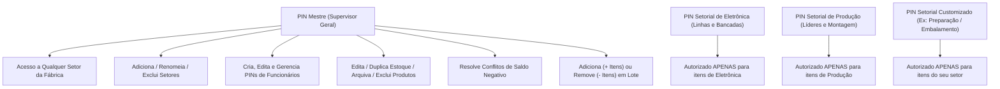

# 📘 Manual de Uso do Sistema — Estoque Luxpryme

**Versão do Sistema:** 1.5.0 (Edição Local-First Zero-Latency)  
**Data da Edição:** Novembro de 2026  
**Empresa:** Luxpryme Indústria Eletrônica  
**Arquiteto de Software e Administrador Geral:** Tomas Pereyra  
**Ambientes Suportados:** Windows 10/11 (Desktop) e Android 7.0+ (Celulares e Coletores)

---

## 📑 Sumário

1. [Visão Geral do Sistema](#1-visão-geral-do-sistema)
2. [Arquitetura Local-First Zero-Latency (0ms)](#2-arquitetura-local-first-zero-latency-0ms)
3. [Arquitetura de Setores: Estoque Compartilhado vs Estoques Separados (Duplicar Estoque)](#3-arquitetura-de-setores-estoque-compartilhado-vs-estoques-separados-duplicar-estoque)
4. [Controle de Acesso e Hierarquia de PINs](#4-controle-de-acesso-e-hierarquia-de-pins)
5. [Interface do Usuário: Desktop vs Versão Mobile Redesenhada](#5-interface-do-usuário-desktop-vs-versão-mobile-redesenhada)
6. [Como Navegar, Buscar Produtos (Melhor Coincidência Fluida) e Filtrar](#6-como-navegar-buscar-produtos-melhor-coincidência-fluida-e-filtrar)
7. [Gestão de Categorias por Setor e Troca de Categoria de Produtos em Lote](#7-gestão-de-categorias-por-setor-e-troca-de-categoria-de-produtos-em-lote)
8. [Gestão em Lote de Setores (+ Itens e - Itens)](#8-gestão-em-lote-de-setores--itens-e---itens)
9. [Movimentação de Estoque, Carrinho com Observação e Baixa com PIN](#9-movimentação-de-estoque-carrinho-com-observação-e-baixa-com-pin)
10. [Cadastro, Edição, Unidades de Medida (Unidade, Peso, Metro, Volume) e Lixeira](#10-cadastro-edição-unidades-de-medida-unidade-peso-metro-volume-e-lixeira)
11. [Produtos Arquivados (Itens Fora de Uso com Saldo em Estoque)](#11-produtos-arquivados-itens-fora-de-uso-com-saldo-em-estoque)
12. [Relatório Completo de Setor e de Arquivados (Exportação Direta em PDF e CSV)](#12-relatório-completo-de-setor-e-de-arquivados-exportação-direta-em-pdf-e-csv)
13. [Gerenciamento e Edição de Setores Dinâmicos](#13-gerenciamento-e-edição-de-setores-dinâmicos)
14. [Painel do Administrador e Edição de Funcionários / PINs (Exclusivo Windows)](#14-painel-do-administrador-e-edição-de-funcionários--pins-exclusivo-windows)
15. [Operação 100% Offline-First e Sincronização Completa com o Supabase](#15-operação-100-offline-first-e-sincronização-completa-com-o-supabase)
16. [Detecção e Resolução de Conflitos de Estoque (Saldo Negativo)](#16-detecção-e-resolução-de-conflitos-de-estoque-saldo-negativo)
17. [Histórico, Rastreabilidade e Exportação de Movimentações em PDF e CSV](#17-histórico-rastreabilidade-e-exportação-de-movimentações-em-pdf-e-csv)
18. [Instalação em Novos Computadores e Celulares](#18-instalação-em-novos-computadores-e-celulares)
19. [Perguntas Frequentes e Solução de Problemas](#19-perguntas-frequentes-e-solução-de-problemas)

---

## 1. Visão Geral do Sistema

O **Estoque Luxpryme** é o software oficial de controle de estoque industrial da Luxpryme, desenvolvido para suportar desde laboratórios eletrônicos de precisão até linhas automatizadas de montagem SMD, soldagem PTH, montagem de luminárias e almoxarifado fabril.

### Principais Destaques da Versão 1.5.0:
* **Resposta Instantânea (Zero-Latency UI):** Todas as ações de cadastro, edição de produto, duplicação de estoque, arquivamento, ajuste de saldo, baixa no carrinho, troca de categorias em lote, edição de setores e PINs respondem em **0 milissegundos**.
* **Duplicar Estoque em Outro Setor e Soma Consolidada na Aba "Todas":** Permite tanto compartilhar um mesmo estoque entre setores (quando o item é armazenado em um setor e usado em mais de um) quanto **duplicar o estoque** para outro setor criando **dois estoques separados e independentes do mesmo produto**. Na aba **Todas**, o sistema consolida os estoques separados em **1 único card** mostrando a **soma total** e o detalhe de quanto há em cada setor.
* **Escolha da Forma de Contagem / Unidade de Medida:** Ao editar ou cadastrar cada produto, é possível escolher como contá-lo: **Unidade (`un`)**, **Peso (`kg` ou `g`)**, **Metro (`m` ou `cm`)** ou **Volume (`L` ou `mL`)**.
* **Troca de Categoria de Produtos em Lote:** Permite selecionar múltiplos produtos dentro de uma categoria e transferi-los para outra categoria de uma só vez.
* **Busca Fluida com Espera Inteligente e Melhor Coincidência:** O buscador aguarda o usuário terminar de escrever (ou pressionar `Enter`) antes de atualizar a lista, evitando travamentos durante a digitação e trazendo as melhores coincidências diretamente no topo.
* **Exportação Direta de Relatórios como Arquivo PDF:** Todos os relatórios do sistema (Setor, Arquivados e Histórico de Movimentação) possuem botão **`Exportar PDF`** que abre a janela **"Salvar como..."** no Windows (e compartilhamento/salvamento nativo no Android), além de botão separado para **`Imprimir`** e **`Salvar / Copiar CSV`**.
* **Seção de Produtos Arquivados por Setor:** Área dedicada a produtos fora de uso que ainda possuem saldo em estoque, organizados por setor e totalmente editáveis.

---

## 2. Arquitetura Local-First Zero-Latency (0ms)

Na versão 1.5.0, o Estoque Luxpryme opera sob uma arquitetura puramente **Local-First com Latência Zero**, garantindo a máxima fluidez no chão de fábrica:

### Princípios de Funcionamento:
1. **Mutação Local Imediata (0ms):**
   * Ao clicar em "Salvar Produto", "Salvar Alterações", "Duplicar Estoque", "Trocar Categoria", "Arquivar", "Confirmar Baixa" ou "+1/-1", a alteração é aplicada imediatamente nas estruturas em memória e nos caches em disco (`local_products_cache.json`, `local_categories_cache.json`, `local_sectors_cache.json`, `local_operator_pins_cache.json`).
   * A interface atualiza instantaneamente e os diálogos fecham sem exibir telas de carregamento (*loading spinners*) bloqueantes.
2. **Sincronização Desacoplada (Background Workers):**
   * As chamadas de rede com a nuvem (Supabase / PostgreSQL) são disparadas em tarefas assíncronas em segundo plano (`unawaited`).
   * Ao cadastrar um novo produto, duplicar estoque ou criar uma categoria, o app insere o item de imediato com identificador local seguro e reconcilia o UUID nativo silenciosamente quando o banco confirma.
3. **Validação de Credenciais no Cache:**
   * A checagem de autorização dos PINs de 4 dígitos é executada diretamente contra a lista de operadores armazenada em memória em menos de **0,01ms**, atribuindo com precisão o nome do operador responsável no histórico.
4. **Resiliência Total contra Quedas de Rede:**
   * Caso a conexão falhe ou oscile durante a sincronização em segundo plano, a operação é depositada na **Fila de Sincronização Offline** (`pending_sync_queue.json`) para ser processada automaticamente quando a internet voltar.

---

## 3. Arquitetura de Setores: Estoque Compartilhado vs Estoques Separados (Duplicar Estoque)

Para organizar estoques de grande porte e segmentar as responsabilidades por setor da fábrica, o sistema adota a separação por **Setores**.

### 3.1. Os Setores Padrão:

| Setor | Cor Visual | Descrição e Finalidade |
| :--- | :--- | :--- |
| **Eletrônica** | 🔵 Azul | Componentes SMD, componentes PTH, circuitos integrados, PCBs virgens e placas montadas/testadas. Setor exclusivo do laboratório eletrônico. |
| **Produção** | 🟢 Verde | Componentes mecânicos, carcaças plásticas, lentes, parafusos, baterias, chicotes e insumos usados na montagem do produto final de iluminação. |
| **Outros** | ⚪ Cinza Slate | Insumos gerais de fábrica, manutenção predial, hidráulica, civil, limpeza e ferramentas de apoio. |

### 3.2. Modo 1 — Estoque Compartilhado entre Setores
Se um produto é **armazenado em um único local mas utilizado por mais de um setor**, ele pode ter mais de um setor marcado dentro do mesmo cadastro (via `Editar Produto` ou `Mover Setor`). Nesse caso, ambos os setores visualizam e movimentam aquele mesmo estoque compartilhado.

### 3.3. Modo 2 — Estoques Separados por Setor (`Duplicar estoque`)
Quando um produto está adicionado em um setor (por exemplo, *Eletrônica*) e você deseja manter um **segundo estoque físico separado do mesmo produto em outro setor** (por exemplo, *Produção*):
1. No card do produto, abra o menu de opções (`⋮`) e clique em **`Duplicar estoque`**.
2. Na janela **Duplicar Estoque em Outro Setor**:
   - **Selecione o Setor para o Novo Estoque** (apenas setores onde o produto ainda não possui estoque estarão disponíveis para seleção).
   - **Informe a Quantidade Inicial neste Setor** (na unidade de medida configurada do produto).
   - **Informe a Localização Física neste Setor** (opcional, ex: *Bancada Montagem 2*).
3. Confirme com seu **PIN de 4 dígitos**.
4. **Como o sistema exibe os estoques separados:**
   - **Na aba do Setor 1 (ex: Eletrônica):** Mostra apenas o estoque da Eletrônica (ex: `25 un`).
   - **Na aba do Setor 2 (ex: Produção):** Mostra apenas o estoque da Produção (ex: `15 un`).
   - **Na aba `Todas`:** O sistema consolida os estoques separados do mesmo produto em **1 único card**, exibindo a **Soma Total dos Estoques** (ex: `40 un`) e os indicadores coloridos detalhando quanto há em cada setor (`Eletrônica: 25 un` • `Produção: 15 un`).
   - Ao clicar em `+1`, `-1`, `Pegar...` ou `Editar` diretamente na aba **`Todas`** em um card consolidado, o aplicativo pergunta em 1 clique qual dos estoques setoriais você deseja movimentar ou editar.

---

## 4. Controle de Acesso e Hierarquia de PINs

O sistema protege o estoque definindo alçadas de autorização através de PINs numéricos de 4 dígitos individuais por funcionário ou bancada:

### Regras de Permissão e Auditoria:
1. **PIN Mestre (Acesso a Todos os Setores):**
   - Autorização irrestrita para retirar, depositar, editar, duplicar estoque ou arquivar qualquer item do catálogo.
   - É o **único** autorizado a adicionar, renomear ou excluir Setores, resolver conflitos de saldo negativo e usar as funções de lote `+ Itens` e `- Itens`.
2. **PIN Setorial (Eletrônica / Produção / Personalizado):**
   - Autorizado a movimentar e gerenciar apenas itens vinculados ao seu respectivo Setor.
   - Caso tente finalizar um carrinho contendo itens de outro setor, a requisição é bloqueada por segurança.
3. **Atribuição Exata no Histórico:**
   - Toda operação autenticada por PIN grava exclusivamente o nome e o setor do funcionário titular daquele PIN.
   - Ações rápidas de bancada que não exigem PIN (como ajustes unitários rápidos `+1` e `-1`) são registradas no histórico de forma neutra (`Ajuste Direto (+/-)`), garantindo que o nome do administrador nunca seja atribuído indevidamente a operações feitas por outros colaboradores.

---

## 5. Interface do Usuário: Desktop vs Versão Mobile Redesenhada

O aplicativo foi otimizado para proporcionar a melhor ergonomia tanto em monitores de alta resolução quanto em celulares:

### Versão Celular (Mobile):
* **Menu Superior Limpo:** Logotipo oficial da Luxpryme, ícone de Lupa de busca expansível, Carrinho de Separação com contador vermelho, botão de **Relatório**, **Arquivados**, **Histórico**, **Lixeira**, **Sincronizar** e **Logout**.
* **Barra de Setores Compacta:** Ocupa espaço reduzido na tela com chips horizontais e botão de ordenação rápida integrado à direita.
* **Acesso às Categorias do Setor no Mobile:** Para visualizar as categorias técnicas vinculadas ao setor atual, basta **manter pressionado (toque longo / long press)** o chip do setor em que você se encontra.
* **Menu de Ações Flutuante (Canto Inferior Direito):** Um botão redondo abre uma lista suspensa com ícones dedicados para todas as ferramentas essenciais:
  - `+ Carrinho (Adicionar Produtos)` (Buscar e selecionar vários produtos informando a quantidade ao lado direito).
  - `+ Itens` (Duplicar estoque ou adicionar múltiplos produtos a um setor).
  - `- Itens` (Remover múltiplos produtos de um setor).
  - `Novo Item` (Cadastrar produto com escolha de unidade de medida e PIN em 0ms).
  - `Categorias de Estoque` (Criar, renomear ou excluir categorias do setor).
  - `Trocar Categoria de Produtos` (Selecionar produtos dentro de uma categoria e mudar para outra).
  - `Gerenciar Setores` (Criar, renomear ou excluir setores com PIN Mestre).
  - `Relatório de Setor` (Exportar relatório PDF ou CSV do setor atual ou de arquivados).
  - `Biblioteca de Modelos` (Visão estruturada em árvore).
  - `Arquivados` (Acessar o estoque de produtos fora de uso divididos por setor).
  - `Lixeira de Produtos` (Recuperar produtos excluídos).
  - `Sobre o Aplicativo (v1.5.0)`.

### Versão Computador (Desktop Windows):
* Exibe a versão `v1.5.0` no cabeçalho superior, barra de busca ampla central, barra de categorias filtrada pelo setor selecionado (com botão rápido **`⇄ Trocar Produtos de Categoria`** ao selecionar uma categoria), atalhos diretos no cabeçalho e menu flutuante inferior completo.

---

## 6. Como Navegar, Buscar Produtos (Melhor Coincidência Fluida) e Filtrar

### 6.1. Busca Inteligente com Espera de Digitação e Melhor Coincidência
O motor de busca da versão 1.5.0 foi projetado para máxima fluidez e precisão:
* **Espera Você Terminar de Escrever (*Debounce* Inteligente):** Enquanto você digita as letras na barra de pesquisa, a lista não fica pulando nem travando a cada tecla pressionada. Assim que você termina de escrever (ou aperta `Enter`), o sistema processa a busca de uma só vez em menos de 2 milissegundos.
* **Frase Exata e Pares Consecutivos no Topo:** Ao buscar por exemplo `placa eletronica slim ac`, os produtos que possuem exatamente a sequência `PLACA ELETRONICA SLIM AC` aparecem imediatamente nas primeiras posições.
* **Precisão em Siglas e Termos Curtos:** Termos técnicos curtos de 1 ou 2 caracteres (como `ac`, `dc`, `ir`, `uv`, `v2`) são comparados por **limite exato de palavra**, evitando falsos positivos.
* **Insensível a Acentos e Busca por Código:** Ignora acentos e cedilhas automaticamente e localiza pelo **Código Interno** ou **Part Number** com prioridade máxima.

### 6.2. Filtro Rápido por Setores e Categorias do Setor
Na barra horizontal colorida:
* **Todas:** Catálogo completo ativo (consolidando e somando estoques separados do mesmo produto).
* **Eletrônica / Produção / Outros / Setores Personalizados:** Filtra imediatamente os estoques atribuídos ao setor selecionado.
* **Barra de Categorias Contextual:** Ao selecionar um setor específico, a barra de categorias abaixo mostra **exclusivamente as categorias cadastradas naquele setor**.

### 6.3. Ordenação Dinâmica
Quando o campo de busca está vazio, você pode ordenar a lista clicando no botão **Ordenar**:
* **Melhor Coincidência**
* **Nome (A - Z)** / **Nome (Z - A)**
* **Menor Estoque** / **Maior Estoque**
* **Último Modificado**

---

## 7. Gestão de Categorias por Setor e Troca de Categoria de Produtos em Lote

As categorias técnicas organizam as famílias de componentes dentro de cada setor da fábrica.

### 7.1. Categorias Exclusivas por Setor
* Cada categoria cadastrada fica vinculada ao(s) setor(es) onde foi criada.
* Quando você está navegando em um setor, o menu e a barra de categorias exibem **apenas as categorias pertencentes àquele setor**.

### 7.2. Criar ou Renomear uma Categoria
1. Clique em **Nova Categoria** na barra de filtros (ou **Categorias de Estoque** no menu inferior direito).
2. **Para Criar:** Digite o nome da nova categoria, marque o(s) setor(es) e clique em **Criar Categoria**.
3. **Para Mudar o Nome (Editar):** Clique no ícone de **lápis (Editar)** ao lado de qualquer categoria, digite o novo nome e clique em **Salvar**. Todos os produtos que utilizavam aquela categoria passam a exibir o novo nome imediatamente em 0ms.

### 7.3. Selecionar Produtos Dentro de uma Categoria e Trocar a Categoria Deles
Para transferir um ou vários produtos de uma categoria para outra sem abrir produto por produto:
1. Acesse a ferramenta por qualquer um dos 3 caminhos:
   - **Na Barra de Categorias:** Clique em uma categoria na barra horizontal e toque no botão **`⇄ Trocar Produtos de Categoria`** que aparece ao lado das subcategorias.
   - **Em Categorias de Estoque:** Clique no ícone **`⇄`** ao lado de qualquer categoria da lista (ou no botão **`Trocar Produtos de Categoria`** no topo da janela).
   - **No Menu Inferior Direito:** Selecione **`Trocar Categoria de Produtos`**.
2. Na janela **Trocar Categoria de Produtos**:
   - **1. Categoria Atual (Origem):** Escolha a categoria de onde deseja tirar os produtos (ou selecione *Sem Categoria*).
   - **2. Nova Categoria (Destino):** Escolha a categoria para onde os produtos serão transferidos (ou selecione *Remover categoria*).
   - **3. Selecione os Produtos:** Pesquise ou clique nos produtos da lista para marcá-los (ou clique no botão **`Todos`** para selecionar todos os itens visíveis daquela categoria de uma só vez).
3. Clique em **`Trocar Categoria`**. A transferência ocorre instantaneamente em 0ms e sincroniza em segundo plano com o Supabase.

### 7.4. Excluir Categoria Mesmo com Produtos Vinculados
* Você pode excluir qualquer categoria clicando no ícone de **lixeira** ao lado dela, **mesmo que existam produtos atualmente cadastrados nessa categoria**.
* Os produtos vinculados **não são apagados do estoque**: eles permanecem intactos no mesmo setor, apenas ficando desvinculados da categoria excluída.

---

## 8. Gestão em Lote de Setores (+ Itens e - Itens)

Disponível no menu flutuante inferior direito, essa ferramenta permite adicionar ou remover múltiplos produtos de um setor rapidamente.

### 8.1. Adicionar em Lote (+ Itens)
1. Abra o menu inferior direito e clique em **+ Itens**.
2. Selecione o **Setor de Destino** (ex: *Produção*).
3. Escolha o **Modo de Adição**:
   - **`Duplicar estoque (estoque separado)`** *(Padrão)*: Cria um segundo estoque independente (iniciando com saldo `0`) no setor de destino para cada produto selecionado.
   - **`Compartilhar mesmo estoque`**: Vincula o setor de destino ao mesmo estoque já existente do produto.
4. Pesquise e selecione os itens desejados:
   - Um contador em **círculo azul** informa a quantidade de itens marcados.
   - Ao selecionar um componente, o texto da barra de busca é apagado automaticamente, mas a **lista permanece congelada na mesma posição** até que você volte a digitar.
5. Clique em **Adicionar ao Setor** e autorize com o **PIN Mestre do Supervisor**.

### 8.2. Remover em Lote (- Itens)
1. Abra o menu inferior direito e clique em **- Itens**.
2. Selecione o Setor do qual deseja desvincular itens.
3. Selecione os produtos a remover e autentique com o **PIN Mestre**.

---

## 9. Movimentação de Estoque, `+ Carrinho` em Lote, Carrinho com Observação e Baixa com PIN

O sistema oferece três modos ágeis de movimentação de saldo com resposta imediata e respeito à unidade de medida do produto (`un`, `kg`, `g`, `m`, `cm`, `L`, `mL`):

### Modo A: Ajuste Unitário Instantâneo (+1 / -1)
* **Finalidade:** Pequenas baixas ou reposições rápidas de 1 unidade/medida em bancada.
* **Como fazer:** No card do produto, toque nos botões `+` ou `-`. O saldo atualiza imediatamente no aparelho e salva no histórico em 0ms.

### Modo B: `+ Carrinho (Adicionar Produtos)` — Seleção Rápida em Lote com Quantidade à Direita
* **Finalidade:** Montar rapidamente uma lista de separação com vários produtos em sequência (com funcionamento idêntico ao `+ Itens`).
* **Como acessar:**
  - Pelo **Menu de Ações** inferior direito -> **`+ Carrinho (Adicionar Produtos)`**; ou
  - Dentro do próprio **Carrinho de Separação**, clicando no botão **`+ Produtos`** no topo (ou **`+ Adicionar Produtos ao Carrinho`**).
* **Passo a Passo:**
  1. Escolha no topo o **Setor** para filtrar (ou *Todos os Setores*) e o tipo de operação: **Retirar do Estoque (Saída)** ou **Repor no Estoque (Entrada)**.
  2. Pesquise o componente pelo nome, código interno ou P/N.
  3. **Campo de Quantidade do Lado Direito:** Ao clicar no produto ou digitar diretamente um valor no campo de quantidade à direita da linha (que também conta com botões `-` e `+` e exibe a unidade de medida do item), o produto é marcado automaticamente.
  4. **Fluxo Contínuo sem Perda de Posição:** Assim que um produto é marcado, o texto da barra de pesquisa é limpo para o próximo item, mantendo a lista na mesma posição até que você volte a digitar, enquanto o contador em círculo azul na barra de busca soma quantos produtos já foram escolhidos.
  5. Clique em **`Adicionar ao Carrinho`** para enviar todos os produtos e suas quantidades de uma só vez ao carrinho.

### Modo C: Carrinho de Separação (Requisições em Lote e Ordem de Produção)
* **Finalidade:** Conferência final, anotação de ordem de serviço e baixa conjunta autenticada por PIN.
* **Passo a Passo:**
  1. Você pode adicionar itens tanto pelo **`+ Carrinho (Adicionar Produtos)`** quanto clicando no botão **`Pegar...`** diretamente no card de qualquer produto.
  2. Abra o **Carrinho** tocando no ícone do carrinho no topo da tela.
  3. **Observação Opcional da Requisição:** Digite uma anotação técnica (ex: *"Linha 2 - Ordem de Produção #840"*).
  4. Toque em **Finalizar com PIN** e digite o **PIN de 4 dígitos** do operador.

---

## 10. Cadastro, Edição, Unidades de Medida (Unidade, Peso, Metro, Volume) e Lixeira

### 10.1. Cadastrar ou Editar um Produto e Escolher Como Contar
1. Clique em **Novo Item** no menu inferior direito (ou em **Editar item** no menu `⋮` de qualquer card).
2. Preencha os dados técnicos:
   - **Nome do Componente ou Placa** (Obrigatório).
   - **Código Interno (Cód. Int)** e **Código Fabricante / P/N**.
   - **Setor(es)**, **Categorias** e **Sub-categorias**.
3. **Escolha Como Contar este Produto (Unidade de Medida):**
   - **Unidade (`un`):** Contagem padrão por peças/unidades.
   - **Peso (`kg / g`):** Permite escolher entre **Quilogramas (`kg`)** ou **Gramas (`g`)**.
   - **Metro (`m / cm`):** Permite escolher entre **Metros (`m`)** ou **Centímetros (`cm`)**.
   - **Volume (`L / mL`):** Permite escolher entre **Litros (`L`)** ou **Mililitros (`mL`)**.
   *(Os campos de Estoque Atual, Estoque Mínimo, Cards, Carrinho e Relatórios passam a exibir automaticamente a unidade escolhida).*
4. Informe o **Estoque Atual / Inicial**, **Estoque Mínimo**, **Localização Física** e **Observações Técnicas**.
5. Clique em **Salvar Alterações** (ou **Cadastrar Item** confirmando com PIN).

### 10.2. Lixeira de Produtos e Restauração de Itens Excluídos
* Ao clicar em **Excluir item** no card do produto e confirmar com PIN, o item não é perdido: ele vai para a **Lixeira de Produtos**.
* Para recuperar, abra a **Lixeira** no cabeçalho superior ou menu inferior, pesquise o item, clique em **Restaurar** e confirme com seu PIN de 4 dígitos.

---

## 11. Produtos Arquivados (Itens Fora de Uso com Saldo em Estoque)

A seção **Arquivados** serve para produtos que **ainda estão fisicamente no estoque, mas que não são mais utilizados** nas linhas atuais.

* **Como Arquivar:** No menu `⋮` do card do produto, clique em **Arquivar item** e confirme com PIN.
* **Divisão por Setor:** Dentro da tela de **Produtos Arquivados** (acessível pelo ícone de arquivo na barra superior ou no menu inferior), os produtos ficam divididos exatamente pelo setor a que pertenciam quando foram arquivados (*Todos Arquivados*, *Eletrônica*, *Produção*, *Outros*, etc.).
* **Edição Completa Enquanto Arquivado:** Produtos arquivados podem ter sua quantidade (`+1`/`-1` ou carrinho), unidade de medida, setor, categorias, códigos e localização modificados normalmente, ou podem ser duplicados e desarquivados (`Desarquivar item`) a qualquer momento.

---

## 12. Relatório Completo de Setor e de Arquivados (Exportação Direta em PDF e CSV)

O gerador de relatórios emite o inventário completo de qualquer setor ativo ou dos produtos arquivados.

### 12.1. Como Gerar e Ordenar
1. Clique no botão de **Relatório** na barra superior (ou **Relatório de Setor** no menu inferior direito; ou **Relatório Arquivados** dentro da tela de Arquivados).
2. **1. Escolha o Setor:** Selecione o setor desejado (*Eletrônica*, *Produção*, *Outros*, setores customizados ou *Todos os Setores*).  
   *(Quando "Todos os Setores" é selecionado, estoques separados do mesmo produto são consolidados automaticamente com a soma total).*
3. **2. Ordenação do Relatório:**
   - **Por Código Interno:** Ordem numérica/natural crescente pelo Código Interno.
   - **Alfabético por Nome (A - Z):** Ordem alfabética pelo nome do produto.

### 12.2. Dados Incluídos
Cada linha do relatório contém exclusivamente os 3 dados essenciais:
1. **Código Interno**
2. **Nome do Produto**
3. **Quantidade no Estoque** (com a respectiva unidade de medida: `un`, `kg`, `g`, `m`, `cm`, `L`, `mL`)

### 12.3. Exportar Arquivo PDF, Imprimir ou Salvar CSV
Na parte inferior da janela do relatório, você dispõe de 3 botões independentes:
* **`Exportar PDF`:**
  - **No Windows:** Abre a janela nativa **"Salvar como..."** do Windows (sugerindo a pasta *Downloads* e o nome do arquivo `.pdf`), salva o documento PDF diretamente no computador e o abre automaticamente no visualizador padrão.
  - **No Android:** Salva o arquivo `.pdf` e abre a gaveta nativa do sistema para salvar em *Downloads* ou enviar por WhatsApp, Drive, e-mail, etc.
* **`Imprimir`:** Abre o diálogo de impressão para enviar diretamente a uma impressora física.
* **`Salvar / Copiar CSV`:** Salva a planilha `.csv` compatível com Excel e copia os dados para a área de transferência.

---

## 13. Gerenciamento e Edição de Setores Dinâmicos

Com o **PIN Mestre do Supervisor**, é possível criar novos setores, **renomear setores existentes** ou removê-los em **Gerenciar Setores**:
* **Criar Novo Setor:** Informe o nome, descrição, cor e ícone e confirme com o PIN Mestre.
* **Mudar o Nome de um Setor:** Clique no ícone de **lápis (Editar)** ao lado do setor, digite o novo nome e confirme com o PIN Mestre. O novo nome atualiza imediatamente em todas as abas, cartões de produtos, relatórios e cartões de funcionários.

---

## 14. Painel do Administrador e Edição de Funcionários / PINs (Exclusivo Windows)

Disponível no computador para o administrador autenticado (`tomibr20@gmail.com`):
* **Cadastrar Novo Funcionário:** Defina o nome do colaborador, o PIN numérico exclusivo de 4 dígitos e o setor autorizado (*Todos os Setores* ou um setor específico).
* **Editar Nome, PIN ou Setor de Funcionário:** Clique no ícone de **lápis (Editar)** no cartão de qualquer funcionário para alterar seu nome, trocar seu PIN de 4 dígitos ou mudar seu setor autorizado em **0ms**, sincronizando em segundo plano com o Supabase.
* **Revogar PIN:** Clique no ícone de lixeira ao lado do funcionário.

---

## 15. Operação 100% Offline-First e Sincronização Completa com o Supabase

* **Trabalho Sem Internet:** Todo o catálogo (> 5.420 produtos), categorias, setores, arquivados e PINs ficam salvos localmente em disco. O aplicativo abre em 0ms mesmo sem Wi-Fi.
* **Botão Sincronizar com Supabase (`Atualizar`):** Descarrega todas as ações pendentes da fila local com segurança e baixa em seguida as atualizações mais recentes de produtos, categorias, setores, PINs e histórico feitas em outros dispositivos.

---

## 16. Detecção e Resolução de Conflitos de Estoque (Saldo Negativo)

Caso dois aparelhos offline retirem unidades do mesmo item simultaneamente gerando saldo negativo após a sincronização, um banner vermelho alerta no topo da tela com 4 opções rápidas (protegidas por PIN Mestre):
1. **Zerar Saldo (0 un)**
2. **Informar Saldo Real** contado fisicamente na prateleira
3. **Estornar Déficit**
4. **Dispensar Notificação**

---

## 17. Histórico, Rastreabilidade e Exportação de Movimentações em PDF e CSV

Na tela de **Histórico & Relatórios**:
* **Filtros Avançados:** Filtre por palavra-chave, origem (*Carrinho* vs *Ajuste Direto*), operador (titular do PIN), período/data específica, categoria e tipo de movimento.
* **Agrupamento Inteligente no Mesmo Momento:** Ajustes unitários rápidos (`+` e `-`) feitos em sequência no mesmo momento são agrupados em um único **cartão expansível** ("Ver todos").
* **Exportação em PDF e CSV:** Clique em **Gerar Relatório** no histórico e escolha entre **`Exportar PDF`** (para salvar o arquivo `.pdf` A4 do histórico filtrado) ou **`Copiar CSV`**.

---

## 18. Instalação em Novos Computadores e Celulares (Tendo o `.zip` ou `.apk`)

Esta seção explica o passo a passo completo para instalar ou atualizar o **Estoque Luxpryme** utilizando o pacote **`LuxprymeStock-Windows.zip`** (para computadores Windows) ou o instalador **`app-release.apk`** (para celulares e coletores Android).

---

### 18.1. Instalação no Computador (Windows 10 / 11) — Tendo o arquivo `.zip`

O pacote do Windows (`LuxprymeStock-Windows.zip`) é um sistema portátil completo: não exige instaladores complexos nem permissões de administrador de rede.

#### Passo 1: Extrair o arquivo `.zip` (Obrigatório)
> **Importante:** **Não** abra o `luxpryme_stock.exe` diretamente de dentro da janela do arquivo `.zip` compactado. O aplicativo precisa que todas as pastas (`data`) e bibliotecas (`.dll`) estejam extraídas juntas na mesma pasta para funcionar.

1. Copie ou baixe o arquivo **`LuxprymeStock-Windows.zip`** para o computador.
2. Clique com o **botão direito do mouse** sobre o arquivo `LuxprymeStock-Windows.zip` e selecione **"Extrair Tudo..."** (ou utilize o WinRAR / 7-Zip clicando em *"Extrair para LuxprymeStock-Windows"*).
3. Escolha uma pasta fixa no computador para guardar o sistema — por exemplo:
   - `C:\LuxprymeStock` ou
   - `Documentos\LuxprymeStock`
4. Clique em **Extrair**.

#### Passo 2: Abrir o aplicativo pela primeira vez
1. Abra a pasta que foi extraída.
2. Localize o arquivo **`luxpryme_stock.exe`** (ícone azul com a letra **"L"** branca da Luxpryme) e dê dois cliques nele.
3. **Caso apareça o aviso azul do Windows Defender SmartScreen** (*"O Windows protegeu o seu computador"* — comum em softwares corporativos internos):
   - Clique no link **"Mais informações"** (logo abaixo do texto);
   - Em seguida, clique no botão **"Executar assim mesmo"** que aparecerá na parte inferior da janela.
   *(Esse aviso só aparece na primeira execução).*

#### Passo 3: Criar um atalho na Área de Trabalho (Desktop)
Para facilitar o acesso diário dos operadores:
1. Dentro da pasta extraída, clique com o **botão direito do mouse** sobre o arquivo **`luxpryme_stock.exe`**.
   *(No Windows 11, clique primeiro em **"Mostrar mais opções"**)*.
2. Passe o mouse em **"Enviar para"** e clique em **"Área de trabalho (criar atalho)"**.
3. Você também pode fixar o programa na barra inferior do Windows: com o aplicativo aberto, clique com o botão direito no ícone dele na Barra de Tarefas e selecione **"Fixar na barra de tarefas"**.

#### Passo 4: Como atualizar o aplicativo no Windows quando receber um novo `.zip`
1. **Feche** o aplicativo Estoque Luxpryme caso ele esteja aberto no computador.
2. Extraia o novo arquivo `LuxprymeStock-Windows.zip` na mesma pasta onde o sistema está instalado, escolhendo **"Substituir os arquivos no destino"** (ou apague a pasta antiga do executável e extraia a nova).
3. Seus dados locais, cache do catálogo e sessão permanecem salvos automaticamente.

---

### 18.2. Instalação no Celular ou Coletor (Android) — Tendo o arquivo `.apk`

O aplicativo para Android é distribuído através do arquivo instalador **`app-release.apk`**.

#### Passo 1: Enviar o arquivo `.apk` para o celular
1. Envie o arquivo **`app-release.apk`** para o celular ou coletor de dados por qualquer um dos meios abaixo:
   - **WhatsApp** (enviando como documento);
   - **Google Drive** ou **E-mail**;
   - **Cabo USB** conectado ao computador (copiando para a pasta *Download* do aparelho).

#### Passo 2: Permitir a instalação e instalar o aplicativo
1. No celular, toque diretamente sobre o arquivo **`app-release.apk`** (pelo WhatsApp ou abrindo o aplicativo **Arquivos / Meus Arquivos** -> pasta **Downloads**).
2. **Caso o Android exiba o aviso de permissão** (*"Para sua segurança, seu smartphone não tem permissão para instalar apps desconhecidos desta fonte"*):
   - Toque no botão **"Configurações"** na mensagem;
   - Ative a chave **"Permitir desta fonte"** (ou *"Autorizar desta fonte"*);
   - Toque na seta de **Voltar** do celular.
3. Toque no botão **"Instalar"** e aguarde alguns segundos.
4. **Caso apareça um aviso do Google Play Protect** (*"O app não foi reconhecido"* — exibido porque é um aplicativo interno da empresa e não está público na Play Store):
   - Toque em **"Mais detalhes"**;
   - Toque em **"Instalar assim mesmo"** (ou *"Instalar sem verificar"*).

#### Passo 3: Abrir e usar no celular
1. Quando a mensagem *"App instalado"* aparecer, toque em **"Abrir"**.
2. O ícone azul **"L" (Estoque Luxpryme)** ficará salvo na tela inicial e na gaveta de aplicativos do celular.
3. Na primeira abertura, insira o e-mail e a senha corporativos. O aplicativo baixará todo o catálogo para a memória local do aparelho e passará a abrir instantaneamente (inclusive offline).

#### Passo 4: Como atualizar o aplicativo no Android quando receber um novo `.apk`
1. Não é necessário desinstalar a versão antiga.
2. Basta enviar o novo arquivo **`app-release.apk`** para o celular, tocar sobre ele e clicar em **"Atualizar"** (ou **"Instalar"**). O Android atualizará o aplicativo mantendo seus dados e login intactos.

---

## 19. Perguntas Frequentes e Solução de Problemas

### 1. "Como crio dois estoques separados do mesmo produto em setores diferentes?"
No card do produto, toque no menu `⋮` e selecione **`Duplicar estoque`**. Escolha o outro setor, digite a quantidade inicial daquele setor e confirme com seu PIN. Na aba de cada setor você verá a quantidade individual daquele setor, e na aba **`Todas`** você verá **1 único card** com a soma dos dois estoques e o detalhe de quanto há em cada setor.

### 2. "Como mudo a forma de contagem de um produto para Peso, Metro ou Volume?"
Abra o menu `⋮` do produto -> **Editar item**. Na seção **"Como Contar este Produto (Unidade de Medida)"**, escolha entre **Unidade (`un`)**, **Peso (`kg` ou `g`)**, **Metro (`m` ou `cm`)** ou **Volume (`L` ou `mL`)** e clique em **Salvar Alterações**.

### 3. "Como seleciono vários produtos de uma categoria para passá-los para outra categoria?"
Clique na categoria desejada na barra superior e toque no botão **`⇄ Trocar Produtos de Categoria`** (ou clique no ícone `⇄` dentro de **Categorias de Estoque**). Marque os produtos desejados (ou clique em **Todos**), escolha a categoria de destino e clique em **Trocar Categoria**.

### 4. "Como salvo um relatório como arquivo PDF no computador sem precisar de impressora?"
Na janela do relatório, clique no botão azul **`Exportar PDF`**. O aplicativo abrirá a janela **"Salvar como..."** do Windows para você escolher a pasta onde deseja salvar o arquivo `.pdf` e já abrirá o arquivo salvo na tela.

---

*Estoque Luxpryme — Controle de Estoque Industrial de Alta Precisão (Versão 1.5.0).*
