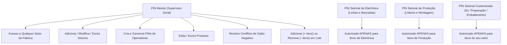

# 📘 Manual de Uso do Sistema — Estoque Luxpryme

**Versão do Sistema:** 1.3.0 (Edição Local-First Zero-Latency)  
**Data da Edição:** Novembro de 2026  
**Empresa:** Luxpryme Indústria Eletrônica  
**Desenvolvedor e Administrador Geral:** Tomas Pereyra  
**Ambientes Suportados:** Windows 10/11 (Desktop) e Android 7.0+ (Celulares e Coletores)

---

## 📑 Sumário

1. [Visão Geral do Sistema](#1-visão-geral-do-sistema)
2. [Arquitetura Local-First Zero-Latency (0ms)](#2-arquitetura-local-first-zero-latency-0ms)
3. [Arquitetura de Setores da Fábrica](#3-arquitetura-de-setores-da-fábrica)
4. [Controle de Acesso e Hierarquia de PINs](#4-controle-de-acesso-e-hierarquia-de-pins)
5. [Interface do Usuário: Desktop vs Versão Mobile Redesenhada](#5-interface-do-usuário-desktop-vs-versão-mobile-redesenhada)
6. [Como Navegar, Buscar Produtos e Filtrar](#6-como-navegar-buscar-produtos-e-filtrar)
7. [Gestão em Lote de Setores (+ Itens e - Itens)](#7-gestão-em-lote-de-setores--itens-e---itens)
8. [Movimentação de Estoque, Carrinho com Observação e Baixa com PIN](#8-movimentação-de-estoque-carrinho-com-observação-e-baixa-com-pin)
9. [Cadastro e Edição Instantânea de Produtos](#9-cadastro-e-edição-instantânea-de-produtos)
10. [Gerenciamento de Setores Dinâmicos](#10-gerenciamento-de-setores-dinâmicos)
11. [Painel do Administrador (Exclusivo Windows)](#11-painel-do-administrador-exclusivo-windows)
12. [Operação 100% Offline-First e Sincronização em Segundo Plano](#12-operação-100-offline-first-e-sincronização-em-segundo-plano)
13. [Detecção e Resolução de Conflitos de Estoque (Saldo Negativo)](#13-detecção-e-resolução-de-conflitos-de-estoque-saldo-negativo)
14. [Histórico, Rastreabilidade e Exportação de Relatórios](#14-histórico-rastreabilidade-e-exportação-de-relatórios)
15. [Instalação em Novos Computadores e Celulares](#15-instalação-em-novos-computadores-e-celulares)
16. [Perguntas Frequentes e Solução de Problemas](#16-perguntas-frequentes-e-solução-de-problemas)

---

## 1. Visão Geral do Sistema

O **Estoque Luxpryme** é o software oficial de controle de estoque industrial da Luxpryme, desenvolvido para suportar desde laboratórios eletrônicos de precisão até linhas automatizadas de montagem SMD, soldagem PTH, montagem de luminárias e almoxarifado fabril.

### Principais Destaques da Versão 1.3.0:
* **Resposta Instantânea (Zero-Latency UI):** Todas as ações de cadastro, edição de produto, ajuste de estoque, baixa no carrinho e reclassificação de setores respondem em **0 milissegundos**. O usuário nunca fica bloqueado por requisições de rede.
* **Catálogo Completo em Alta Performance:** Carregamento fluido de todo o catálogo industrial (> 5.420 produtos cadastrados).
* **Tecnologia Offline-First com Cache em Disco:** O sistema baixa todo o catálogo uma única vez. Ao reabrir o app, o carregamento é instantâneo (**0 segundos de espera**), funcionando perfeitamente sem internet ou com sinal instável.
* **Sincronização Silenciosa em Segundo Plano:** Assim que houver conexão, as alterações feitas offline ou locais são enviadas de forma assíncrona para a nuvem via Supabase sem travar a interface.
* **Validação de PIN Ultrarrápida:** Verificação imediata do PIN numérico no cache em memória (**0,001ms**), eliminando latência na confirmação de operações.
* **Detecção Automática de Conflitos:** Se dispositivos desconectados retirarem produtos simultaneamente e o saldo ficar negativo, o sistema alerta e disponibiliza opções imediatas para regularizar o estoque.
* **Separação por Setores:** Organização clara entre *Eletrônica*, *Produção*, *Outros* e setores customizados adicionados pela supervisão.
* **Rastreabilidade e Segurança com PIN de 4 Dígitos:** Toda separação de peças exige o PIN do operador, garantindo auditoria completa com registro opcional de observação técnica.

---

## 2. Arquitetura Local-First Zero-Latency (0ms)

Na versão 1.3.0, o Estoque Luxpryme opera sob uma arquitetura puramente **Local-First com Latência Zero**, garantindo a máxima fluidez no chão de fábrica:

### Princípios de Funcionamento:
1. **Mutação Local Imediata (0ms):**
   * Ao clicar em "Salvar Produto", "Salvar Alterações", "Confirmar Baixa" ou "+1/-1", a alteração é aplicada imediatamente nas estruturas em memória (`_allProducts`, `_localProducts`) e no cache em disco (`local_products_cache.json`).
   * A interface atualiza instantaneamente e os diálogos fecham sem exibir telas de carregamento (*loading spinners*) bloqueantes.
2. **Sincronização Desacoplada (Background Workers):**
   * As chamadas de rede com a nuvem (Supabase / PostgreSQL) são disparadas em tarefas assíncronas em segundo plano (`unawaited`).
   * Ao cadastrar um novo produto, o app insere o item de imediato com identificador local seguro. Quando o banco de dados confirma a gravação e gera o UUID nativo, o sistema reconcilia o registro silenciosamente em segundo plano, sem qualquer recarregamento perceptível.
3. **Validação de Credenciais no Cache:**
   * A checagem de autorização dos PINs de 4 dígitos é executada diretamente contra a lista de operadores armazenada em memória, reduzindo o tempo de validação de ~1.500ms para menos de **0,01ms**.
4. **Resiliência Total contra Quedas de Rede:**
   * Caso a conexão falhe ou oscile durante a sincronização em segundo plano, a operação não é perdida: ela é depositada na **Fila de Sincronização Offline** (`pending_sync_queue.json`) para ser processada automaticamente quando a internet voltar.

---

## 3. Arquitetura de Setores da Fábrica

Para organizar estoques de grande porte e segmentar as responsabilidades por setor da fábrica, o sistema adota a separação por **Setores**.

### Os Setores Padrão:

| Setor | Cor Visual | Descrição e Finalidade |
| :--- | :--- | :--- |
| **Eletrônica** | 🔵 Azul | Componentes SMD, componentes PTH, circuitos integrados, PCBs virgens e placas montadas/testadas. Setor exclusivo do laboratório eletrônico. |
| **Produção** | 🟢 Verde | Componentes mecânicos, carcaças plásticas, lentes, parafusos, baterias, chicotes e insumos usados na montagem do produto final de iluminação. |
| **Outros** | ⚪ Cinza Slate | Insumos gerais de fábrica, manutenção predial, hidráulica, civil, limpeza e ferramentas de apoio. |

### Compartilhamento entre Setores:
Um produto pode pertencer a **mais de um Setor** ao mesmo tempo.  
*Exemplo:* Uma bateria industrial ou chicote elétrico soldado na bancada de eletrônica e também utilizado na linha de montagem pode ter marcados os setores **Eletrônica** e **Produção**. Operadores de ambos os setores poderão requisitá-lo.

---

## 4. Controle de Acesso e Hierarquia de PINs

O sistema protege o estoque definindo alçadas de autorização através de PINs numéricos de 4 dígitos:

### Regras de Permissão:
1. **PIN Mestre (Acesso a Todos os Setores):**
   - Autorização irrestrita para retirar ou depositar qualquer item do catálogo.
   - É o **único** autorizado a adicionar, modificar ou excluir Setores, resolver conflitos de saldo negativo e usar as funções de lote `+ Itens` e `- Itens`.
2. **PIN Setorial (Eletrônica / Produção / Personalizado):**
   - Autorizado a movimentar apenas itens vinculados ao seu respectivo Setor.
   - Caso tente finalizar um carrinho contendo itens de outro setor, a requisição é bloqueada por segurança.

---

## 5. Interface do Usuário: Desktop vs Versão Mobile Redesenhada

O aplicativo foi otimizado para proporcionar a melhor ergonomia tanto em monitores de alta resolução quanto em celulares:

### Versão Celular (Mobile):
* **Menu Superior Limpo:** Logotipo oficial da Luxpryme, ícone de Lupa de busca expansível, Carrinho de Separação com contador vermelho, Histórico de Movimentações, Botão de Sincronizar e Botão de Logout.
* **Barra de Setores Compacta:** Ocupa espaço reduzido na tela com chips horizontais e botão de ordenação rápida integrado à direita.
* **Acesso às Categorias Comuns no Mobile:** Para visualizar as categorias técnicas comuns (ex: *Componentes SMD*, *Baterias*, etc.), basta **manter pressionado (toque longo / long press)** o chip do setor em que você se encontra.
* **Menu de Ações Flutuante (Canto Inferior Direito):** Um botão redondo abre uma lista suspensa com todas as ferramentas essenciais:
  - `+ Itens` (Adicionar múltiplos produtos a um setor).
  - `- Itens` (Remover múltiplos produtos de um setor).
  - `Novo Item` (Cadastrar produto com PIN em 0ms).
  - `Gerenciar Categorias Comuns`.
  - `Gerenciar Setores` (com PIN Mestre).
  - `Modo Biblioteca` (Visão estruturada em árvore).

### Versão Computador (Desktop Windows):
* Exibe a barra de busca ampla central, atalhos de administração no cabeçalho e menu flutuante inferior para operações rápidas em lote (`+ Itens` e `- Itens`).

---

## 6. Como Navegar, Buscar Produtos e Filtrar

### 6.1. Busca Inteligente por Palavras Desordenadas
A busca quebra o texto em termos independentes. Não é necessário digitar o nome na ordem exata:
* Digitando `farol placa 16` o sistema encontra `MONTAGEM PLACA ELETRONICA FAROL 16 LEDS`.
* Digitando o **Código Interno** (ex: `6857`) ou o **Part Number** do fabricante, o item é localizado imediatamente.

### 6.2. Filtro Rápido por Setores
Na barra horizontal colorida:
* **Todas:** Catálogo completo.
* **Eletrônica:** Apenas componentes de laboratório e placas.
* **Produção:** Apenas insumos e materiais de montagem final.
* **Outros:** Almoxarifado geral e manutenção.
* **Setores Personalizados:** Filtra imediatamente os produtos atribuídos ao setor criado.

### 6.3. Ordenação Dinâmica
Ao clicar no ícone de ordenar (ou no menu suspenso), escolha entre:
* **Nome (A - Z)** / **Nome (Z - A)**
* **Menor Estoque** (destaca itens esgotados ou críticos) / **Maior Estoque**
* **Último Modificado** (destaca peças recém-movimentadas)

---

## 7. Gestão em Lote de Setores (+ Itens e - Itens)

Disponível no menu flutuante inferior direito, essa ferramenta permite reclassificar rapidamente centenas de itens sem precisar abrir produto por produto.

### 7.1. Adicionar em Lote (+ Itens)
1. Abra o menu inferior direito e clique em **+ Itens**.
2. Selecione o **Setor de Destino** (ex: *Produção*).
3. **Filtro Inteligente:** O sistema exibe apenas os produtos que **ainda não pertencem** a esse setor.
4. Digite o nome ou código no campo de busca.
5. Toque/clique nos itens desejados para selecioná-los:
   - Um contador em **círculo azul** com número branco surge à direita informando a quantidade de itens marcados.
   - **Navegação Contínua sem Perda de Posição:** Ao selecionar um componente, o texto da barra de busca é apagado automaticamente para deixar o campo pronto para o próximo item, mas a **lista permanece exatamente na mesma posição e com os mesmos resultados visíveis**. A lista só muda de posição quando você começa a digitar uma nova busca, permitindo selecionar múltiplos itens próximos sem saltos na tela.
6. Clique em **Adicionar ao Setor**.
7. Digite o **PIN Mestre do Supervisor** para autenticar a alteração. O catálogo é atualizado na hora em 0ms.

### 7.2. Remover em Lote (- Itens)
1. Abra o menu inferior direito e clique em **- Itens**.
2. Selecione o Setor do qual deseja desvincular itens.
3. **Filtro Exclusivo:** O sistema exibe **apenas os produtos que já pertencem** a esse setor.
4. Selecione os produtos a remover (com a mesma preservação suave de rolagem e limpeza do campo de texto).
5. Clique em **Remover do Setor** e autentique com o **PIN Mestre**.  
   *(Se um produto ficar sem nenhum setor vinculado, ele é transferido automaticamente para "Outros" por segurança).*

---

## 8. Movimentação de Estoque, Carrinho com Observação e Baixa com PIN

O sistema oferece dois modos de movimentação de saldo com resposta imediata:

### Modo A: Ajuste Unitário Instantâneo (+1 / -1)
* **Finalidade:** Pequenas baixas ou reposições de 1 unidade em bancada.
* **Como fazer:** No card do produto, toque nos botões `+` ou `-`. O saldo atualiza imediatamente no aparelho e salva no histórico em 0ms.

### Modo B: Carrinho de Separação (Requisições em Lote e Ordem de Produção)
* **Finalidade:** Separação de kits de componentes para ordens de serviço ou entrada de remessas de fornecedores.
* **Passo a Passo:**
  1. No card do produto, toque no botão **Pegar / Movimentar**.
  2. Defina a quantidade e escolha **Saída (Retirada)** ou **Entrada (Depósito)**.
  3. Adicione todos os componentes necessários à lista de separação.
  4. Abra o **Carrinho** tocando no ícone do carrinho no topo da tela.
  5. **Observação Opcional da Requisição:** No campo de texto antes da finalização, você pode digitar uma anotação (ex: *"Linha 2 - Ordem de Produção #840"* ou *"Bancada de Testes PTH"*).
  6. Toque em **Finalizar com PIN**.
  7. Digite o **PIN de 4 dígitos** do operador.
  8. O sistema valida as permissões no cache local (**0,001ms**) e abate/adiciona o saldo de todos os itens simultaneamente, registrando a observação no histórico de auditoria e sincronizando em segundo plano.

---

## 9. Cadastro e Edição Instantânea de Produtos

Com a arquitetura Local-First, o salvamento de cadastros e edições não depende da velocidade da internet:

### 9.1. Cadastrar um Novo Item
1. No menu inferior direito, clique em **Novo Item**.
2. Preencha as informações:
   - **Nome do Produto** (Obrigatório).
   - **Código Interno / P/N Fabricante / Código de Barras**.
   - **Setores:** Marque os setores autorizados (*Eletrônica*, *Produção*, *Outros*, etc.).
   - **Categoria Técnica Comum e Sub-categorias**.
   - **Estoque Inicial e Estoque Mínimo de Alerta**.
   - **Localização:** Ex: *Gaveteiro A3, Prateleira 2*.
3. Digite um **PIN de Operador** autorizado para o setor do item.
4. Clique em **Cadastrar Item**.
5. **Resultado Instantâneo (0ms):** A tela fecha de imediato, o novo item já aparece ordenado no topo da lista e o histórico de criação é registrado. O envio ao servidor ocorre em segundo plano.

### 9.2. Editar ou Excluir Produto
* No menu de opções do card (`...`), clique em **Editar**.
* Modifique qualquer informação técnica ou quantidade e clique em **Salvar Alterações**. O diálogo fecha na hora e a lista reflete a mudança imediatamente.
* Para excluir, clique em **Excluir Produto** e confirme com o **PIN autorizado** correspondente ao setor.
* **Segurança Anti-Exclusão Acidental:** O produto não é apagado de forma destrutiva imediata; ele é transferido para a **Lixeira de Produtos**, mantendo todo seu histórico e dados intactos para recuperação futura.

### 9.3. Lixeira de Produtos e Restauração de Itens Excluídos
Caso um produto tenha sido excluído por engano ou precise retornar ao catálogo ativo:
1. Abra a **Lixeira de Produtos** tocando no ícone de lixeira no cabeçalho superior ou através do menu flutuante inferior direito.
2. Localize o componente excluído pela barra de pesquisa por Nome, Código Interno ou P/N.
3. Clique no botão **Restaurar**.
4. Digite seu PIN de 4 dígitos para autorizar.
5. **Retorno Imediato:** O produto é restaurado instantaneamente com a mesma quantidade de estoque e configurações de setor que possuía antes da exclusão.
6. A supervisão geral também pode esvaziar a lixeira definitivamente quando necessário com o PIN Mestre.

---

## 10. Gerenciamento de Setores Dinâmicos

Com o **PIN Mestre do Supervisor**, é possível cadastrar novos setores da fábrica sem precisar de suporte técnico.

### Como Cadastrar um Novo Setor:
1. No menu inferior direito (ou painel admin), clique em **Gerenciar Setores**.
2. Clique em **+ Novo Setor**.
3. Preencha:
   - **Nome do Setor** (ex: *Preparação*, *Embalamento*, *Corte de Cabos*).
   - Descrição breve.
   - Cor de identificação visual e ícone representativo.
4. Digite o **PIN Mestre de 4 dígitos** e confirme.
5. O novo setor surge imediatamente nas abas, filtros e telas de cadastro de PINs (salvo localmente e sincronizado com a nuvem).

---

## 11. Painel do Administrador (Exclusivo Windows)

Disponível no computador para o usuário administrador autenticado (`tomibr20@gmail.com`).

### Funcionalidades:
* **Cadastro de PINs de Operadores:**
  1. Digite o nome do operador ou bancada (ex: *Bancada Solda PTH 2*).
  2. Digite o PIN numérico exclusivo de 4 dígitos.
  3. Selecione a alçada: **Mestre (Acesso a Todos os Setores)** ou **Setorial** (*Eletrônica*, *Produção*, *Preparação*, etc.).
  4. Clique em **Cadastrar PIN**.
* **Revogação Instantânea:** Toque no ícone de lixeira ao lado de qualquer operador para revogar o PIN imediatamente.

---

## 12. Operação 100% Offline-First e Sincronização em Segundo Plano

O **Estoque Luxpryme** foi construído com arquitetura de alta disponibilidade para suportar fábricas com galpões distantes ou oscilação de Wi-Fi:

### Como Funciona:
1. **Cache Persistente no Aparelho:** Todo o inventário (> 5.420 produtos) fica gravado na memória interna do celular ou computador.
2. **Abertura em 0ms:** O aplicativo não fica travado em telas de carregamento. Você abre e o catálogo já está pronto para uso.
3. **Trabalho Sem Internet:**
   - Você pode fazer baixas no carrinho, ajustes rápidos (+1/-1), cadastrar itens ou mexer em setores normalmente sem conexão.
   - Cada ação é gravada no banco local e armazenada na **Fila de Sincronização Pendente** (`pending_sync_queue.json`).
4. **Sincronização Automática em Segundo Plano:**
   - Ao detectar conexão com a internet, o sistema descarrega a fila silenciosamente para a nuvem.
   - Não interfere no trabalho do operador.

---

## 13. Detecção e Resolução de Conflitos de Estoque (Saldo Negativo)

### O que é o Conflito de Sincronização?
Se dois dispositivos estiverem operando offline e ambos realizarem a retirada de peças de um mesmo componente que estava com poucas unidades, no momento em que ambos se conectarem à internet o saldo calculado pode ficar negativo (ex: `-3 un`).

### Como o Sistema Notifica:
Um banner de aviso destacado é exibido no topo da tela inicial:
> ⚠️ **Conflito de Estoque: X item(ns) com saldo negativo**  
> *Retiradas simultâneas geraram déficit. Clique para corrigir. [Resolver]*

### Opções de Correção no Diálogo de Conflitos:
Ao clicar em **Resolver**, o gestor tem 4 alternativas para cada item:
1. **Zerar Saldo (0 un):** Redefine o estoque do produto para zero com PIN Mestre e grava um registro de auditoria no histórico.
2. **Informar Saldo Real em Almoxarifado:** Abre um campo para o operador contar fisicamente quantas peças restam na gaveta e atualizar o saldo real com PIN Mestre.
3. **Estornar Déficit:** Reverte o número negativo adicionando a quantidade faltante (ex: se o saldo era `-4 un`, adiciona `+4 un` trazendo a `0 un`).
4. **Dispensar:** Oculta a notificação caso já tenha sido corrigida externamente.

---

## 14. Histórico, Rastreabilidade e Exportação de Relatórios

Para auditar o fluxo de materiais da fábrica:
1. Clique no ícone de **Histórico & Relatórios** no menu superior.
2. Consulte os detalhes de cada registro:
   - Data e hora exatas.
   - Nome do componente, código interno e part number.
   - Tipo de operação: *Carrinho*, *Ajuste Unitário (+1/-1)* ou *Resolução de Conflito*.
   - Saldo anterior e novo saldo resultante.
   - Nome do operador e identificação do PIN.
   - **Observação / Ordem de Produção** anotada no carrinho.
3. **Agrupamento Inteligente no Mesmo Momento:**
   - Quando um operador realiza múltiplos ajustes unitários rápidos usando os botões `+` e `-` no mesmo momento (janela de tempo contínua), o sistema agrupa essas movimentações em um único **cartão expansível** ("Ajustes Unitários (+ / -) • X itens no mesmo momento").
   - Isso elimina dezenas de linhas fragmentadas na tela.
   - Basta clicar em **Ver todos** no cartão para expandir e auditar cada produto ajustado individualmente com seus códigos, horários e saldos resultantes.
4. **Exportar Relatório:** Clique em **Gerar Relatório** para salvar uma planilha CSV compatível com Excel e Google Sheets.

---

## 15. Instalação em Novos Computadores e Celulares

### No Computador (Windows):
1. Copie o arquivo `LuxprymeStock-Windows.zip` para o computador.
2. Clique com o botão direito e selecione **Extrair Tudo**.
3. Abra a pasta extraída e execute `luxpryme_stock.exe`.
4. *Dica:* Crie um atalho na Área de Trabalho para iniciar o sistema diariamente.

### No Celular (Android):
1. Envie o arquivo `app-release.apk` para o celular (via WhatsApp, Google Drive ou cabo USB).
2. Toque no arquivo APK para iniciar a instalação.
3. Permita "Instalar aplicativos de fontes desconhecidas" caso solicitado pelo Android.
4. Abra o **Estoque Luxpryme**. O catálogo e o cache serão configurados automaticamente.

---

## 16. Perguntas Frequentes e Solução de Problemas

### 1. "O aplicativo funciona se eu desligar o Wi-Fi ou ligar o modo avião?"
**Sim.** O sistema possui tecnologia Offline-First. Todas as movimentações continuam funcionando normalmente e serão sincronizadas assim que a conexão retornar.

### 2. "Por que o salvamento é tão rápido agora?"
Na versão 1.3.0, todas as operações salvam primeiro na memória e no disco do dispositivo em 0ms. A sincronização com a nuvem acontece em segundo plano, sem travamentos ou esperas.

### 3. "Como vejo as subcategorias no celular se a barra não aparece?"
No celular, a barra foi condensada para economizar espaço de tela. **Mantenha o dedo pressionado (toque longo)** sobre o botão do Setor desejado para abrir a gaveta com todas as categorias comuns e subcategorias técnicas.

### 4. "Como adicionar vários itens de uma vez para um setor?"
Abra o menu circular no canto inferior direito e toque em **+ Itens**. Selecione o setor de destino e pesquise os itens. Ao tocar em cada um, o sistema conta no círculo azul e limpa a busca automaticamente para agilizar.

### 5. "Por que meu PIN de operador foi rejeitado no carrinho?"
Verifique os setores dos itens selecionados. Um PIN setorial (ex: Eletrônica) só pode movimentar itens de sua área. Para movimentar itens mistos, utilize o PIN de cada setor ou o PIN Mestre do supervisor geral.

### 6. "O que significa o banner de alerta de conflito de estoque?"
Significa que dois operadores deram baixa em um mesmo componente em aparelhos desconectados, fazendo o saldo daquele item ficar abaixo de zero ao sincronizar. Basta clicar em **Resolver** e escolher zerar ou digitar a contagem real física.

---

*Estoque Luxpryme — Controle de Estoque Industrial de Alta Precisão.*

---

*Estoque Luxpryme — Controle de Estoque Industrial de Alta Precisão.*
