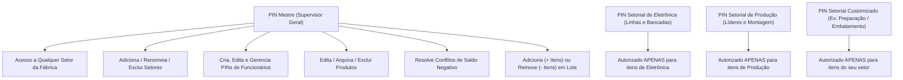

# 📘 Manual de Uso do Sistema — Estoque Luxpryme

**Versão do Sistema:** 1.4.0 (Edição Local-First Zero-Latency)  
**Data da Edição:** Novembro de 2026  
**Empresa:** Luxpryme Indústria Eletrônica  
**Desenvolvedor e Administrador Geral:** Tomas Pereyra  
**Ambientes Suportados:** Windows 10/11 (Desktop) e Android 7.0+ (Celulares e Coletores)

---

## 📑 Sumário

1. [Visão Geral do Sistema](#1-visão-geral-do-sistema)
2. [Arquitetura Local-First Zero-Latency (0ms)](#2-arquitetura-local-first-zero-latency-0ms)
3. [Arquitetura de Setores da Fábrica](#3-arquitetura-de-setores-da-fábrica)
4. [Controle de Acesso e Hierarquia de PINs](#4-controle-de-acesso-e-hierarquia-de-pins)
5. [Interface do Usuário: Desktop vs Versão Mobile Redesenhada](#5-interface-do-usuário-desktop-vs-versão-mobile-redesenhada)
6. [Como Navegar, Buscar Produtos (Melhor Coincidência) e Filtrar](#6-como-navegar-buscar-produtos-melhor-coincidência-e-filtrar)
7. [Gestão de Categorias Técnicas Filtradas por Setor](#7-gestão-de-categorias-técnicas-filtradas-por-setor)
8. [Gestão em Lote de Setores (+ Itens e - Itens)](#8-gestão-em-lote-de-setores--itens-e---itens)
9. [Movimentação de Estoque, Carrinho com Observação e Baixa com PIN](#9-movimentação-de-estoque-carrinho-com-observação-e-baixa-com-pin)
10. [Cadastro, Edição e Lixeira de Produtos](#10-cadastro-edição-e-lixeira-de-produtos)
11. [Produtos Arquivados (Itens Fora de Uso com Saldo em Estoque)](#11-produtos-arquivados-itens-fora-de-uso-com-saldo-em-estoque)
12. [Relatório Completo de Setor e de Produtos Arquivados (PDF e CSV)](#12-relatório-completo-de-setor-e-de-produtos-arquivados-pdf-e-csv)
13. [Gerenciamento e Edição de Setores Dinâmicos](#13-gerenciamento-e-edição-de-setores-dinâmicos)
14. [Painel do Administrador e Edição de Funcionários / PINs (Exclusivo Windows)](#14-painel-do-administrador-e-edição-de-funcionários--pins-exclusivo-windows)
15. [Operação 100% Offline-First e Sincronização Completa com o Supabase](#15-operação-100-offline-first-e-sincronização-completa-com-o-supabase)
16. [Detecção e Resolução de Conflitos de Estoque (Saldo Negativo)](#16-detecção-e-resolução-de-conflitos-de-estoque-saldo-negativo)
17. [Histórico, Rastreabilidade e Exportação de Movimentações](#17-histórico-rastreabilidade-e-exportação-de-movimentações)
18. [Instalação em Novos Computadores e Celulares](#18-instalação-em-novos-computadores-e-celulares)
19. [Perguntas Frequentes e Solução de Problemas](#19-perguntas-frequentes-e-solução-de-problemas)

---

## 1. Visão Geral do Sistema

O **Estoque Luxpryme** é o software oficial de controle de estoque industrial da Luxpryme, desenvolvido para suportar desde laboratórios eletrônicos de precisão até linhas automatizadas de montagem SMD, soldagem PTH, montagem de luminárias e almoxarifado fabril.

### Principais Destaques da Versão 1.4.0:
* **Resposta Instantânea (Zero-Latency UI):** Todas as ações de cadastro, edição de produto, arquivamento, ajuste de estoque, baixa no carrinho, edição de categorias, setores e PINs respondem em **0 milissegundos**. O usuário nunca fica bloqueado por requisições de rede.
* **Seção de Produtos Arquivados por Setor:** Área dedicada a produtos que ainda estão fisicamente no estoque mas que não são mais utilizados nas linhas atuais. Os itens arquivados ficam organizados pelo setor em que estavam quando foram arquivados e continuam permitindo **edição completa** (quantidade, setor, categorias, códigos e observações) ou desarquivamento imediato.
* **Gerador de Relatórios de Setor e de Arquivados (PDF A4 e CSV Excel):** Emissão instantânea do inventário completo de qualquer setor ativo ou dos produtos arquivados, com ordenação selecionável por **Código Interno** ou **Alfabética por Nome (A - Z)**, trazendo exclusivamente **Código Interno**, **Nome do Produto** e **Quantidade no Estoque**.
* **Busca Inteligente por Melhor Coincidência:** Algoritmo de relevância avançada que prioriza no topo da lista os produtos que contêm a expressão exata, pares de palavras consecutivas e termos curtos exatos (como siglas técnicas), ignorando acentos automaticamente.
* **Categorias Filtradas por Setor e Edição Flexível:** A barra e o gerenciador de categorias exibem apenas as categorias cadastradas no setor selecionado. É possível **renomear categorias** a qualquer momento e **excluir categorias mesmo que possuam produtos vinculados** (desvinculando os produtos automaticamente sem apagá-los).
* **Edição Completa de Setores e Funcionários (PINs):** Possibilidade de alterar o nome e atributos dos setores cadastrados, bem como editar o nome, o PIN de 4 dígitos e o setor autorizado de qualquer funcionário no Painel Admin.
* **Sincronização Completa Garantida com o Supabase:** O botão de atualização manual descarrega a fila offline com segurança e baixa em tempo real todas as novas modificações de produtos, categorias, setores, PINs de funcionários e histórico feitas em outros aparelhos.

---

## 2. Arquitetura Local-First Zero-Latency (0ms)

Na versão 1.4.0, o Estoque Luxpryme opera sob uma arquitetura puramente **Local-First com Latência Zero**, garantindo a máxima fluidez no chão de fábrica:

### Princípios de Funcionamento:
1. **Mutação Local Imediata (0ms):**
   * Ao clicar em "Salvar Produto", "Salvar Alterações", "Arquivar", "Confirmar Baixa" ou "+1/-1", a alteração é aplicada imediatamente nas estruturas em memória e nos caches em disco (`local_products_cache.json`, `local_categories_cache.json`, `local_sectors_cache.json`, `local_operator_pins_cache.json`).
   * A interface atualiza instantaneamente e os diálogos fecham sem exibir telas de carregamento (*loading spinners*) bloqueantes.
2. **Sincronização Desacoplada (Background Workers):**
   * As chamadas de rede com a nuvem (Supabase / PostgreSQL) são disparadas em tarefas assíncronas em segundo plano (`unawaited`).
   * Ao cadastrar um novo produto ou categoria, o app insere o item de imediato com identificador local seguro. Quando o banco de dados confirma a gravação e gera o UUID nativo, o sistema reconcilia o registro silenciosamente em segundo plano.
3. **Validação de Credenciais no Cache:**
   * A checagem de autorização dos PINs de 4 dígitos é executada diretamente contra a lista de operadores armazenada em memória, reduzindo o tempo de validação para menos de **0,01ms** e atribuindo com precisão o nome do operador responsável no histórico.
4. **Resiliência Total contra Quedas de Rede:**
   * Caso a conexão falhe ou oscile durante a sincronização em segundo plano, a operação não é perdida: ela é depositada na **Fila de Sincronização Offline** (`pending_sync_queue.json`) para ser processada automaticamente quando a internet voltar.

---

## 3. Arquitetura de Setores da Fábrica

Para organizar estoques de grande porte e segmentar as responsabilidades por setor da fábrica, o sistema adota a separação por **Setores**.

### Os Setores Padrão:

| Setor | Cor Visual | Descrição e Finalidade |
| :--- | :--- | :--- |
| **Eletrônica** | 🔵 Azul | Componentes SMD, componentes PTH, circuitos integrados, PCBs virgens e placas montadas/testadas. Setor exclusivo do laboratório eletrônico. |
| **Produção** | 🟢 Verde | Componentes mecânicos, carcaças plásticas, lentes, parafusos, baterias, chicotes e insumos usados na montagem do produto final de iluminação. |
| **Outros** | ⚪ Cinza Slate | Insumos gerais de fábrica, manutenção predial, hidráulica, civil, limpeza e ferramentas de apoio. |

### Compartilhamento entre Setores:
Um produto pode pertencer a **mais de um Setor** ao mesmo tempo.  
*Exemplo:* Uma bateria industrial ou chicote elétrico soldado na bancada de eletrônica e também utilizado na linha de montagem pode ter marcados os setores **Eletrônica** e **Produção**. Operadores de ambos os setores poderão requisitá-lo.

---

## 4. Controle de Acesso e Hierarquia de PINs

O sistema protege o estoque definindo alçadas de autorização através de PINs numéricos de 4 dígitos individuais por funcionário ou bancada:

### Regras de Permissão e Auditoria:
1. **PIN Mestre (Acesso a Todos os Setores):**
   - Autorização irrestrita para retirar, depositar, editar ou arquivar qualquer item do catálogo.
   - É o **único** autorizado a adicionar, renomear ou excluir Setores, resolver conflitos de saldo negativo e usar as funções de lote `+ Itens` e `- Itens`.
2. **PIN Setorial (Eletrônica / Produção / Personalizado):**
   - Autorizado a movimentar e gerenciar apenas itens vinculados ao seu respectivo Setor.
   - Caso tente finalizar um carrinho contendo itens de outro setor, a requisição é bloqueada por segurança.
3. **Atribuição Exata no Histórico:**
   - Toda operação autenticada por PIN grava exclusivamente o nome e o setor do funcionário titular daquele PIN.
   - Ações rápidas de bancada que não exigem PIN (como ajustes unitários rápidos `+1` e `-1`) são registradas no histórico de forma neutra (`Ajuste Rápido (+1/-1)`), garantindo que o nome do administrador nunca seja atribuído indevidamente a operações feitas por outros colaboradores.

---

## 5. Interface do Usuário: Desktop vs Versão Mobile Redesenhada

O aplicativo foi otimizado para proporcionar a melhor ergonomia tanto em monitores de alta resolução quanto em celulares:

### Versão Celular (Mobile):
* **Menu Superior Limpo:** Logotipo oficial da Luxpryme, ícone de Lupa de busca expansível, Carrinho de Separação com contador vermelho, botão de **Arquivados**, Lixeira, Histórico de Movimentações, Botão de Sincronizar e Botão de Logout.
* **Barra de Setores Compacta:** Ocupa espaço reduzido na tela com chips horizontais e botão de ordenação rápida integrado à direita.
* **Acesso às Categorias do Setor no Mobile:** Para visualizar as categorias técnicas vinculadas ao setor atual, basta **manter pressionado (toque longo / long press)** o chip do setor em que você se encontra.
* **Menu de Ações Flutuante (Canto Inferior Direito):** Um botão redondo abre uma lista suspensa com ícones dedicados para todas as ferramentas essenciais:
  - `+ Itens` (Adicionar múltiplos produtos a um setor).
  - `- Itens` (Remover múltiplos produtos de um setor).
  - `Novo Item` (Cadastrar produto com PIN em 0ms).
  - `Relatório de Setor` (Gerar relatório PDF ou CSV do setor atual ou de arquivados).
  - `Arquivados` (Acessar o estoque de produtos fora de uso divididos por setor).
  - `Lixeira` (Recuperar produtos excluídos).
  - `Gerenciar Categorias` (Criar, renomear ou excluir categorias do setor).
  - `Gerenciar Setores` (Criar, renomear ou excluir setores com PIN Mestre).
  - `Modo Biblioteca` (Visão estruturada em árvore).

### Versão Computador (Desktop Windows):
* Exibe a barra de busca ampla central, barra de categorias filtrada pelo setor selecionado, atalhos diretos no cabeçalho (**Relatório**, **Arquivados**, **Lixeira**, **Histórico**, **Sincronizar** e **Admin PINs**) e menu flutuante inferior completo com ícones visuais em todas as ações.

---

## 6. Como Navegar, Buscar Produtos (Melhor Coincidência) e Filtrar

### 6.1. Busca Inteligente com Ranqueamento de Melhor Coincidência
O motor de busca da versão 1.4.0 analisa todos os termos digitados (ignorando acentos, cedilhas e maiúsculas/minúsculas) e **ordena automaticamente os resultados colocando as melhores coincidências no topo da lista**:
* **Frase Exata e Pares Consecutivos:** Ao buscar por exemplo `placa eletronica slim ac`, os produtos que possuem exatamente a sequência `PLACA ELETRONICA SLIM AC` aparecem imediatamente nas primeiras posições, acima de itens que contenham apenas palavras soltas em posições distantes.
* **Precisão em Siglas e Termos Curtos:** Termos técnicos curtos de 1 ou 2 caracteres (como `ac`, `dc`, `ir`, `uv`, `v2`) são comparados por **limite exato de palavra**, evitando falsos positivos (buscar por `ac` prioriza produtos com a sigla `AC` e não mistura palavras genéricas como *acabamento* ou *pacote*).
* **Busca por Código Interno ou Part Number:** Digitando o **Código Interno** (ex: `6857`) ou o **Part Number** do fabricante, a correspondência exata recebe pontuação máxima e surge no topo imediatamente.

### 6.2. Filtro Rápido por Setores e Categorias do Setor
Na barra horizontal colorida:
* **Todas:** Catálogo completo ativo.
* **Eletrônica / Produção / Outros / Setores Personalizados:** Filtra imediatamente os produtos atribuídos ao setor selecionado.
* **Barra de Categorias Contextual:** Ao selecionar um setor específico (ex: *Eletrônica*), a barra de categorias abaixo mostra **exclusivamente as categorias cadastradas naquele setor**, mantendo a navegação limpa e sem categorias de outras áreas.

### 6.3. Ordenação Dinâmica
Quando o campo de busca está vazio, você pode ordenar a lista clicando no ícone de ordenação:
* **Nome (A - Z)** / **Nome (Z - A)**
* **Menor Estoque** (destaca itens esgotados ou críticos) / **Maior Estoque**
* **Último Modificado** (destaca peças recém-movimentadas)
*(Observação: Enquanto houver texto digitado na barra de pesquisa, o sistema prioriza automaticamente a ordem de **Melhor Coincidência**).*

---

## 7. Gestão de Categorias Técnicas Filtradas por Setor

As categorias técnicas organizam as famílias de componentes dentro de cada setor da fábrica.

### 7.1. Categorias Exclusivas por Setor
* Cada categoria cadastrada fica vinculada ao(s) setor(es) onde foi criada.
* Quando você está navegando em um setor (por exemplo, *Produção*), o menu e a barra de categorias exibem **apenas as categorias pertencentes a Produção**.

### 7.2. Criar ou Renomear uma Categoria
1. Clique no botão **Categorias** na barra de filtros (ou **Gerenciar Categorias** no menu inferior direito).
2. O diálogo exibe as categorias do setor ativo (com opção de alternar o setor no topo do diálogo).
3. **Para Criar:** Digite o nome da nova categoria para o setor atual e clique em **Adicionar**.
4. **Para Mudar o Nome (Editar):** Clique no ícone de **lápis (Editar)** ao lado de qualquer categoria, digite o novo nome e confirme.
   - **Atualização em Cascata Instantânea (0ms):** Todos os produtos que utilizavam aquela categoria passam a exibir o novo nome imediatamente no catálogo local e a mudança é sincronizada em segundo plano com o Supabase.

### 7.3. Excluir Categoria Mesmo com Produtos Vinculados
* Você pode excluir qualquer categoria clicando no ícone de **lixeira** ao lado dela, **mesmo que existam produtos atualmente cadastrados nessa categoria**.
* O sistema informa quantos produtos estão vinculados e, ao confirmar a exclusão:
  - A categoria é removida imediatamente.
  - Os produtos que pertenciam a ela **não são apagados**: eles permanecem intactos no estoque e no mesmo setor, apenas ficando sem essa categoria vinculada (*Sem Categoria*).

---

## 8. Gestão em Lote de Setores (+ Itens e - Itens)

Disponível no menu flutuante inferior direito, essa ferramenta permite reclassificar rapidamente centenas de itens sem precisar abrir produto por produto.

### 8.1. Adicionar em Lote (+ Itens)
1. Abra o menu inferior direito e clique em **+ Itens**.
2. Selecione o **Setor de Destino** (ex: *Produção*).
3. **Filtro Inteligente:** O sistema exibe apenas os produtos que **ainda não pertencem** a esse setor.
4. Digite o nome ou código no campo de busca (com ranqueamento por melhor coincidência).
5. Toque/clique nos itens desejados para selecioná-los:
   - Um contador em **círculo azul** com número branco surge à direita informando a quantidade de itens marcados.
   - **Navegação Contínua sem Perda de Posição:** Ao selecionar um componente, o texto da barra de busca é apagado automaticamente para deixar o campo pronto para o próximo item, mas a **lista permanece exatamente na mesma posição e com os mesmos resultados visíveis**. A lista só muda de posição quando você começa a digitar uma nova busca.
6. Clique em **Adicionar ao Setor** e autorize com o **PIN Mestre do Supervisor**. O catálogo é atualizado na hora em 0ms.

### 8.2. Remover em Lote (- Itens)
1. Abra o menu inferior direito e clique em **- Itens**.
2. Selecione o Setor do qual deseja desvincular itens.
3. **Filtro Exclusivo:** O sistema exibe **apenas os produtos que já pertencem** a esse setor.
4. Selecione os produtos a remover (com a mesma preservação suave de rolagem e limpeza do campo de texto).
5. Clique em **Remover do Setor** e autentique com o **PIN Mestre**.  
   *(Se um produto ficar sem nenhum setor vinculado, ele é transferido automaticamente para "Outros" por segurança).*

---

## 9. Movimentação de Estoque, Carrinho com Observação e Baixa com PIN

O sistema oferece dois modos de movimentação de saldo com resposta imediata:

### Modo A: Ajuste Unitário Instantâneo (+1 / -1)
* **Finalidade:** Pequenas baixas ou reposições rápidas de 1 unidade em bancada.
* **Como fazer:** No card do produto, toque nos botões `+` ou `-`. O saldo atualiza imediatamente no aparelho e salva no histórico em 0ms.

### Modo B: Carrinho de Separação (Requisições em Lote e Ordem de Produção)
* **Finalidade:** Separação de kits de componentes para ordens de serviço ou entrada de remessas de fornecedores.
* **Passo a Passo:**
  1. No card do produto, toque no botão **Pegar / Movimentar**.
  2. Defina a quantidade e escolha **Saída (Retirada)** ou **Entrada (Depósito)**.
  3. Adicione todos os componentes necessários à lista de separação.
  4. Abra o **Carrinho** tocando no ícone do carrinho no topo da tela.
  5. **Observação Opcional da Requisição:** No campo de texto antes da finalização, você pode digitar uma anotação (ex: *"Linha 2 - Ordem de Produção #840"* ou *"Bancada de Testes PTH"*).
  6. Toque em **Finalizar com PIN**.
  7. Digite o **PIN de 4 dígitos** do operador.
  8. O sistema valida as permissões no cache local (**0,001ms**) e abate/adiciona o saldo de todos os itens simultaneamente, registrando o nome exato do funcionário titular do PIN e a observação no histórico de auditoria.

---

## 10. Cadastro, Edição e Lixeira de Produtos

Com a arquitetura Local-First, o salvamento de cadastros e edições não depende da velocidade da internet:

### 10.1. Cadastrar um Novo Item
1. No menu inferior direito, clique em **Novo Item**.
2. Preencha as informações:
   - **Nome do Produto** (Obrigatório).
   - **Código Interno / P/N Fabricante / Código de Barras**.
   - **Setores:** Marque os setores autorizados (*Eletrônica*, *Produção*, *Outros*, etc.).
   - **Categoria Técnica do Setor e Sub-categorias**.
   - **Estoque Inicial e Estoque Mínimo de Alerta**.
   - **Localização:** Ex: *Gaveteiro A3, Prateleira 2*.
3. Digite um **PIN de Operador** autorizado para o setor do item.
4. Clique em **Cadastrar Item**.
5. **Resultado Instantâneo (0ms):** A tela fecha de imediato, o novo item já aparece no catálogo e o envio ao servidor ocorre em segundo plano.

### 10.2. Editar, Arquivar ou Excluir Produto
* No menu de opções do card (`...`), você encontra três ações principais:
  - **Editar:** Modifique qualquer informação técnica, setor, categoria ou quantidade e clique em **Salvar Alterações**.
  - **Arquivar Produto:** Move o produto para a seção de **Arquivados** (ideal para itens que ainda possuem saldo em estoque, mas não são mais usados atualmente).
  - **Excluir Produto:** Move o produto para a **Lixeira de Produtos** mediante confirmação com PIN autorizado.

### 10.3. Lixeira de Produtos e Restauração de Itens Excluídos
Caso um produto tenha sido excluído por engano:
1. Abra a **Lixeira de Produtos** tocando no ícone de lixeira no cabeçalho superior ou através do menu flutuante inferior direito.
2. Localize o componente excluído pela barra de pesquisa.
3. Clique no botão **Restaurar** e confirme com seu PIN de 4 dígitos.
4. O produto retorna instantaneamente ao estoque ativo com a mesma quantidade e setores que possuía antes da exclusão.

---

## 11. Produtos Arquivados (Itens Fora de Uso com Saldo em Estoque)

A seção **Arquivados** foi projetada especificamente para separar componentes e materiais que **ainda estão fisicamente no estoque da empresa, mas que deixaram de ser utilizados** nos projetos ou linhas de produção atuais.

### 11.1. Como Funciona o Arquivamento
* Ao arquivar um produto (pelo menu `...` do produto -> **Arquivar Produto**), ele deixa de poluir a listagem principal do estoque diário, mas **preserva integralmente seu saldo, códigos e setores**.
* Tudo funciona em **0ms (Local-First)** e sincroniza automaticamente com o Supabase em segundo plano.

### 11.2. Organização por Setor Dentro de Arquivados
Para acessar os produtos arquivados:
1. Clique no ícone de **Arquivados** (caixa de arquivo) na barra superior ou selecione **Arquivados** no menu flutuante inferior direito.
2. Na tela de **Produtos Arquivados**, você encontrará a barra horizontal de **Setores** (*Todos*, *Eletrônica*, *Produção*, *Outros* e setores customizados).
3. Os produtos arquivados ficam **divididos exatamente com base no setor a que pertenciam quando foram arquivados**, permitindo consultar rapidamente quais itens obsoletos pertencem ao laboratório eletrônico, à produção ou ao almoxarifado geral.

### 11.3. Edição Completa de Produtos Arquivados
Mesmo estando arquivado, qualquer produto pode ser **modificado normalmente como se estivesse no estoque ativo**:
* **Ajuste Rápido de Quantidade (`+1` e `-1`):** Adicione ou retire unidades diretamente no card do produto arquivado.
* **Movimentação Completa / Carrinho:** Realize entradas ou baixas de quantidade com observação e PIN.
* **Edição Cadastral Completa (`Editar`):** Altere nome, código interno, Part Number, quantidade em estoque, **mude o produto de setor**, altere suas **categorias e subcategorias**, localização física ou observações técnicas.
* **Desarquivar (Retornar ao Estoque Ativo):** Caso o componente volte a ser utilizado pela engenharia ou produção, basta clicar em **Desarquivar** no card do item para devolvê-lo instantaneamente à lista principal do seu setor.

---

## 12. Relatório Completo de Setor e de Produtos Arquivados (PDF e CSV)

O sistema possui um gerador dedicado de relatórios enxutos e padronizados para conferência física, contabilidade e inventário de setores ativos ou de produtos arquivados.

### 12.1. Como Gerar um Relatório de Setor Ativo
1. Na tela principal do estoque, clique no botão **Relatório** (ícone de prancheta/relatório na barra superior) ou escolha **Relatório de Setor** no menu flutuante inferior direito.
2. **Escolha o Escopo:** Selecione o setor desejado (*Eletrônica*, *Produção*, *Outros*, qualquer setor customizado ou *Todos os Setores*), ou marque a chave **Produtos Arquivados** para gerar o relatório dos itens arquivados daquele setor.
3. **Escolha a Ordenação:**
   - **Por Código Interno:** Ordena os produtos em ordem numérica/natural crescente pelo Código Interno (ex: `102`, `540`, `1200`, `6857`), posicionando itens sem código ao final em ordem alfabética.
   - **Alfabético por Nome (A - Z):** Ordena todos os produtos do setor em ordem alfabética rigorosa pelo nome.

### 12.2. Dados Incluídos no Relatório
Conforme o padrão objetivo de conferência da Luxpryme, cada linha de produto no relatório inclui **exclusivamente os 3 dados essenciais**:
1. **Código Interno**
2. **Nome do Produto**
3. **Quantidade no Estoque**

### 12.3. Gerar Relatório Diretamente da Tela de Arquivados
* Dentro da tela de **Produtos Arquivados**, basta clicar no botão **Gerar Relatório de Arquivados** no cabeçalho superior.
* O gerador já abrirá pré-configurado no modo **Produtos Arquivados** e filtrado no setor que você estiver visualizando no momento, permitindo escolher a ordenação por **Código Interno** ou **Alfabético por Nome** da mesma forma.

### 12.4. Formatos de Exportação Disponíveis
No diálogo do relatório, além da **pré-visualização imediata em tabela** com totalizador de produtos e soma total de unidades, você pode:
* **Exportar / Imprimir PDF (A4):** Gera um documento PDF formatado em padrão industrial A4 com cabeçalho do setor, data/hora de emissão, critério de ordenação e tabela paginada pronta para impressão ou salvamento.
* **Exportar CSV (Excel) / Copiar:** Salva o arquivo `.csv` diretamente no computador (compatível com Microsoft Excel e Google Sheets com codificação UTF-8 BOM para acentuação perfeita) ou copia os dados para a área de transferência.

---

## 13. Gerenciamento e Edição de Setores Dinâmicos

Com o **PIN Mestre do Supervisor**, é possível cadastrar novos setores, **mudar o nome de setores existentes** ou remover setores diretamente pelo aplicativo.

### 13.1. Como Cadastrar um Novo Setor
1. No menu inferior direito, clique em **Gerenciar Setores**.
2. Preencha o **Nome do Setor** (ex: *Preparação*, *Embalamento*, *Corte de Cabos*), escolha uma cor visual e um ícone representativo.
3. Clique em **Criar Setor** e autorize com o **PIN Mestre de 4 dígitos**.
4. O novo setor surge imediatamente nas abas, filtros e telas de cadastro de PINs.

### 13.2. Como Mudar o Nome ou Editar um Setor Existente
1. Em **Gerenciar Setores**, localize o setor desejado na lista de setores cadastrados.
2. Clique no ícone de **lápis (Editar)** ao lado do setor.
3. Altere o **Nome do Setor**, a cor ou o ícone e clique em **Salvar**.
4. Confirme com o **PIN Mestre**.
5. **Reflexo Imediato:** O novo nome do setor é atualizado instantaneamente em todas as abas de navegação, nos produtos vinculados, na tela de Arquivados, nos relatórios e nos cartões de funcionários com PIN daquele setor, sincronizando em segundo plano com o Supabase.

---

## 14. Painel do Administrador e Edição de Funcionários / PINs (Exclusivo Windows)

Disponível no computador para o usuário administrador autenticado (`tomibr20@gmail.com`) através do botão **Admin PINs** no topo da tela.

### 14.1. Cadastrar Novo Funcionário e PIN
1. Na aba **Funcionários e PINs**, clique em **Novo Funcionário**.
2. Digite o **Nome do Funcionário** ou bancada (ex: *Bancada Solda PTH 2*).
3. Defina o **PIN numérico exclusivo de 4 dígitos**.
4. Selecione o **Setor Autorizado**: **Supervisor Geral (Todos os Setores)** ou um setor específico (*Eletrônica*, *Produção*, etc.).
5. Clique em **Salvar PIN**.

### 14.2. Editar Nome, PIN ou Setor de um Funcionário Existente
Caso precise alterar o nome de um colaborador, trocar seu código PIN de 4 dígitos ou transferi-lo de setor:
1. Na lista de **Funcionários e PINs**, clique no ícone de **lápis (Editar Funcionário e PIN)** no cartão do colaborador.
2. Modifique o **Nome do Funcionário**, o **PIN de 4 dígitos** e/ou o **Setor Autorizado**.
3. Clique em **Salvar Alterações**.
4. **Atualização Local-First (0ms):** A alteração entra em vigor imediatamente no cache local de validação de PINs e é sincronizada automaticamente com a tabela `operator_pins` no Supabase.

### 14.3. Revogação Instantânea
* Toque no ícone de lixeira ao lado de qualquer funcionário para revogar seu PIN imediatamente.

---

## 15. Operação 100% Offline-First e Sincronização Completa com o Supabase

O **Estoque Luxpryme** foi construído com arquitetura de alta disponibilidade para suportar fábricas com galpões distantes ou oscilação de Wi-Fi:

### 15.1. Trabalho Sem Internet e Cache Persistente
1. **Cache Completo em Disco:** Todo o inventário (> 5.420 produtos), categorias por setor, setores customizados, produtos arquivados e lista de PINs de funcionários ficam gravados na memória interna do computador ou celular.
2. **Abertura em 0ms:** Você abre o aplicativo e o catálogo já está pronto para uso imediato.
3. **Fila de Sincronização Pendente (`pending_sync_queue.json`):** Todas as alterações feitas offline são enfileiradas em segurança na ordem exata em que ocorreram.

### 15.2. Sincronização Manual Completa e Confiável (Botão Atualizar / Sincronizar)
Quando você clica no ícone de **Sincronizar com a Nuvem (Atualizar)** na barra superior:
1. **Envio Seguro das Pendências Locais:** O sistema primeiro descarrega para o Supabase todas as alterações que estavam na fila local do seu aparelho. Se alguma operação falhar por instabilidade momentânea, ela é mantida na fila para não ser sobrescrita.
2. **Download Completo Multi-Tabela:** Em seguida, o aplicativo busca no Supabase as versões mais recentes de **todas as entidades do sistema**:
   - Produtos ativos, produtos arquivados e itens na lixeira;
   - Categorias técnicas e seus vínculos com setores;
   - Setores dinâmicos e nomes atualizados;
   - Funcionários e PINs atualizados;
   - Histórico recente de movimentações.
3. **Confirmação Real:** O aviso verde *"Sincronizado com o Supabase com sucesso"* só é exibido após a interface aplicar e exibir todas as novas modificações vindas da nuvem, ou informa detalhadamente quantas operações ainda aguardam conexão caso a internet esteja indisponível.

---

## 16. Detecção e Resolução de Conflitos de Estoque (Saldo Negativo)

### O que é o Conflito de Sincronização?
Se dois dispositivos estiverem operando offline e ambos realizarem a retirada de peças de um mesmo componente que estava com poucas unidades, no momento em que ambos se conectarem à internet o saldo calculado pode ficar negativo (ex: `-3 un`).

### Como o Sistema Notifica:
Um banner de aviso destacado é exibido no topo da tela inicial:
> ⚠️ **Conflito de Estoque: X item(ns) com saldo negativo**  
> *Retiradas simultâneas geraram déficit. Clique para corrigir. [Resolver]*

### Opções de Correção no Diálogo de Conflitos:
Ao clicar em **Resolver**, o gestor tem 4 alternativas para cada item:
1. **Zerar Saldo (0 un):** Redefine o estoque do produto para zero com PIN Mestre e grava um registro de auditoria no histórico.
2. **Informar Saldo Real em Almoxarifado:** Abre um campo para o operador contar fisicamente quantas peças restam na gaveta e atualizar o saldo real com PIN Mestre.
3. **Estornar Déficit:** Reverte o número negativo adicionando a quantidade faltante (ex: se o saldo era `-4 un`, adiciona `+4 un` trazendo a `0 un`).
4. **Dispensar:** Oculta a notificação caso já tenha sido corrigida externamente.

---

## 17. Histórico, Rastreabilidade e Exportação de Movimentações

Para auditar o fluxo de materiais da fábrica:
1. Clique no ícone de **Histórico & Relatórios** no menu superior.
2. Consulte os detalhes de cada registro:
   - Data e hora exatas.
   - Nome do componente, código interno e part number.
   - Tipo de operação: *Carrinho*, *Ajuste Unitário (+1/-1)* ou *Resolução de Conflito*.
   - Saldo anterior e novo saldo resultante.
   - Nome exato do operador titular do PIN utilizado (ou indicação neutra de ajuste rápido quando realizado sem PIN).
   - **Observação / Ordem de Produção** anotada no carrinho.
3. **Agrupamento Inteligente no Mesmo Momento:**
   - Quando um operador realiza múltiplos ajustes unitários rápidos usando os botões `+` e `-` no mesmo momento (janela de tempo contínua), o sistema agrupa essas movimentações em um único **cartão expansível** ("Ajustes Unitários (+ / -) • X itens no mesmo momento").
   - Basta clicar em **Ver todos** no cartão para expandir e auditar cada produto ajustado individualmente com seus códigos, horários e saldos resultantes.
4. **Exportar Histórico:** Clique em **Gerar Relatório** dentro da tela de histórico para salvar uma planilha CSV de todas as movimentações filtradas.

---

## 18. Instalação em Novos Computadores e Celulares

### No Computador (Windows):
1. Copie o arquivo `LuxprymeStock-Windows.zip` para o computador.
2. Clique com o botão direito e selecione **Extrair Tudo**.
3. Abra a pasta extraída e execute `luxpryme_stock.exe`.
4. *Dica:* Crie um atalho na Área de Trabalho para iniciar o sistema diariamente.

### No Celular (Android):
1. Envie o arquivo `app-release.apk` para o celular (via WhatsApp, Google Drive ou cabo USB).
2. Toque no arquivo APK para iniciar a instalação.
3. Permita "Instalar aplicativos de fontes desconhecidas" caso solicitado pelo Android.
4. Abra o **Estoque Luxpryme**. O catálogo e o cache serão configurados automaticamente.

---

## 19. Perguntas Frequentes e Solução de Problemas

### 1. "Qual a diferença entre Arquivar um produto e Excluir para a Lixeira?"
* **Arquivar (`Arquivados`):** Serve para produtos que **você ainda tem fisicamente no estoque**, mas que a empresa **não utiliza mais** nas linhas atuais. Eles ficam organizados por setor dentro da tela de **Arquivados**, podem ter sua quantidade, setor e categorias editados normalmente e possuem relatório próprio em PDF/CSV.
* **Excluir (`Lixeira`):** Serve para cadastros criados por engano ou itens que devem ser descartados do sistema. Ficam na Lixeira apenas para recuperação de emergência.

### 2. "Posso excluir uma categoria se houver produtos cadastrados nela?"
**Sim.** Na versão 1.4.0, você pode excluir qualquer categoria livremente. Os produtos vinculados a ela não são perdidos: o sistema apenas remove o vínculo da categoria excluída desses produtos automaticamente.

### 3. "Por que algumas categorias não aparecem quando troco de setor?"
Para manter a tela limpa e organizada, o menu de categorias mostra **apenas as categorias cadastradas no setor atualmente selecionado**. Para ver todas as categorias da fábrica de uma só vez, selecione a aba **Todas** na barra de setores.

### 4. "Como gero uma lista de inventário de um setor ordenada por Código Interno ou Nome?"
Clique no botão **Relatório** na barra superior (ou **Relatório de Setor** no menu inferior direito), selecione o setor desejado (ou ative a chave **Produtos Arquivados**), escolha a ordenação (**Por Código Interno** ou **Alfabético por Nome**) e clique em **Exportar / Imprimir PDF** ou **Exportar CSV (Excel)**. O relatório trará de forma limpa apenas o Código Interno, o Nome e a Quantidade no Estoque de cada item.

### 5. "Como altero o nome de uma categoria, de um setor ou de um funcionário com PIN?"
* **Categoria:** Clique em **Categorias** na barra de filtros e toque no ícone de **lápis** ao lado da categoria.
* **Setor:** Abra o menu inferior -> **Gerenciar Setores** -> toque no ícone de **lápis** ao lado do setor e confirme com o PIN Mestre.
* **Funcionário / PIN:** No Windows, clique em **Admin PINs** no topo -> aba **Funcionários e PINs** -> clique no ícone de **lápis** no cartão do funcionário para alterar o nome, o PIN de 4 dígitos ou o setor.

---

*Estoque Luxpryme — Controle de Estoque Industrial de Alta Precisão (Versão 1.4.0).*
