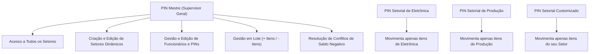

<div align="center">
  
  <h1>Estoque Luxpryme</h1>
  <p><strong>Sistema Industrial de Controle de Almoxarifado e Estoque de Alta Precisão</strong></p>
  <p>
    <b>Versão 1.4.0</b> • <b>Local-First Zero-Latency (0ms)</b> • <b>100% Offline-First</b> • <b>Setores & Arquivados</b> • <b>Relatórios PDF/CSV</b> • <b>Rastreabilidade por PIN</b>
  </p>
  <p>
    Desenvolvido e Administrado por <b>Tomas Pereyra</b> para <b>Luxpryme Indústria Eletrônica</b>
  </p>

  <p>
    
    
    
    
    
  </p>
</div>

---

## 🎨 Identidade Visual Corporativa

O **Estoque Luxpryme** adota uma identidade visual sóbria, funcional e moderna, desenhada especificamente para ambientes industriais, galpões fabris e laboratórios eletrônicos:

* **Símbolo Oficial:** Quadrado com cantos arredondados em **Azul Luxpryme** (`#1976D2`) destacando a letra **"L"** em **branco puro** com proporção geométrica harmoniosa e excelente legibilidade.
* **Paleta de Cores Setorial:**
  * 🔵 **Azul Luxpryme (`#1976D2`):** Setor de Laboratório Eletrônico (SMD, PTH, PCBs, ICs) e cor mestra do sistema.
  * 🟢 **Verde Produção (`#16A34A`):** Setor de Produção Industrial (montagem mecânica, chicotes, baterias e luminárias).
  * ⚪ **Cinza Slate (`#64748B`):** Setor Outros (almoxarifado geral, manutenção fabril, civil e insumos de apoio).
  * 🟣 **Cores Customizadas:** Novos setores criados pela supervisão podem receber cores exclusivas (ex: Roxo para *Embalamento*, Laranja para *Preparação*).
* **Feedback de Estoque:**
  * 🟢 **Verde (`#16A34A`):** Estoque Saudável / Normal.
  * 🟡 **Âmbar (`#D97706`):** Estoque Baixo (próximo ao ponto de pedido).
  * 🔴 **Vermelho (`#DC2626`):** Estoque Esgotado / Alerta de Saldo Negativo.
* **Tipografia:** Família *Inter* para interface de alta densidade e *Montserrat* no símbolo corporativo.

---

## 🏭 Arquitetura por Setores da Fábrica

Para suportar grandes volumes e evitar interferências entre áreas produtivas, o estoque é estruturado em **Setores**:



* **Multi-Vínculo:** Um produto pode pertencer a mais de um setor simultaneamente (ex: um chicote ou bateria usado tanto no laboratório eletrônico quanto na linha de montagem final).
* **Setores Dinâmicos Editáveis:** Novos setores industriais (ex: *Preparação de Fios*, *Embalamento*, *Expedição*) podem ser criados, **renomeados** ou editados a qualquer momento pelo supervisor com PIN Mestre diretamente pelo app.

---

## 🚀 Principais Recursos da Versão 1.4.0

### 1. Arquitetura Local-First Zero-Latency (0ms) & Sincronização Completa
* **Resposta Imediata na Interface:** Todas as operações de cadastrar novo item, editar produto, arquivar/desarquivar, editar categorias, renomear setores, editar funcionários/PINs, ajuste unitário (`+1`/`-1`) ou finalização de carrinho acontecem **instantaneamente na memória e no cache local** em **0 milissegundos**.
* **Zero Telas de Espera:** Diálogos e formulários fecham de imediato sem exibir *loading spinners* ou travar o operador.
* **Sincronização Completa Multi-Tabela (`syncAllWithSupabase`):** O botão de atualização manual descarrega a fila offline com segurança (preservando itens que falharem por queda de rede) e baixa simultaneamente produtos, categorias, setores, PINs de operadores e histórico antes de confirmar a sincronização na tela.
* **Validação Instantânea de PIN (0,001ms):** Autenticação realizada diretamente no cache em memória, atribuindo com precisão o funcionário titular do PIN no histórico.

### 2. Produtos Arquivados Divididos por Setor (`Arquivados`)
* **Gestão de Estoque Fora de Uso:** Seção exclusiva para produtos que a empresa ainda possui fisicamente em estoque, mas que não são mais utilizados nas linhas de produção atuais.
* **Divisão por Setor de Origem:** Dentro de **Arquivados**, os itens são filtrados pelos mesmos setores da fábrica (*Eletrônica*, *Produção*, *Outros* e setores customizados) com base no setor a que pertenciam quando foram arquivados.
* **Edição Completa Enquanto Arquivado:** Produtos arquivados podem ser modificados exatamente como itens ativos — incluindo ajustes rápidos de quantidade (`+1`/`-1`), movimentação de entrada/saída, troca de setor, edição de categorias, códigos e localização, além de desarquivamento em 1 clique.

### 3. Gerador de Relatórios de Setor e de Arquivados (PDF A4 & CSV Excel)
* **Relatório Enxuto e Padronizado:** Gera o inventário completo de qualquer setor ativo ou dos **Produtos Arquivados** (por setor ou geral).
* **Ordenação Configurável:** Escolha entre ordenação numérica natural **Por Código Interno** ou **Alfabética por Nome (A - Z)**.
* **Campos Essenciais:** Inclui exclusivamente **Código Interno**, **Nome do Produto** e **Quantidade no Estoque**, com pré-visualização instantânea, impressão/exportação em **PDF A4** paginado e exportação em **CSV (compatível com Excel)**.

### 4. Busca Inteligente com Ranqueamento de Melhor Coincidência
* **Algoritmo de Relevância Avançado:** Prioriza no topo dos resultados os produtos com correspondência exata da frase buscada, bônus para pares de palavras consecutivas (`bigramas`), início do nome e densidade de termos.
* **Precisão em Siglas Técnicas:** Termos curtos de 1 a 2 letras (como `ac`, `dc`, `ir`, `uv`) são validados por limite exato de palavra (*word boundary*), garantindo que buscas como `"placa eletronica slim ac"` posicionem a melhor coincidência diretamente em 1º lugar.
* **Insensível a Acentos:** Busca bidirecional normalizada que ignora acentos e cedilhas tanto no texto digitado quanto nos cadastros.

### 5. Categorias Filtradas por Setor, Renomeação e Exclusão Livre
* **Filtro Contextual por Setor:** O menu e a barra de categorias exibem exclusivamente as categorias vinculadas ao setor atualmente selecionado.
* **Edição de Nome em Cascata (0ms):** Permite renomear qualquer categoria existente, atualizando instantaneamente todos os produtos vinculados localmente e no Supabase.
* **Exclusão Livre de Categorias:** Permite excluir uma categoria mesmo que existam produtos vinculados a ela — os produtos permanecem intactos no estoque e são automaticamente desvinculados da categoria removida.

### 6. Edição Completa de Setores e Funcionários com PIN
* **Renomeação de Setores:** Possibilidade de alterar o nome, ícone e cor de setores cadastrados, refletindo a mudança imediatamente nos produtos, filtros e cartões de operadores.
* **Edição de Funcionários e PINs:** No Painel Admin, é possível editar o nome do funcionário, alterar seu PIN de 4 dígitos ou mudar seu setor autorizado em 0ms com sincronização em segundo plano.

### 7. Gestão em Lote de Setores (`+ Itens` e `- Itens`)
* **`+ Itens` e `- Itens`:** Ferramentas com busca por relevância e contador dinâmico (círculo azul) para adicionar ou remover múltiplos produtos de um setor. A busca limpa automaticamente o campo a cada seleção enquanto a lista permanece congelada na exata posição onde o item foi clicado, só mudando quando o usuário volta a digitar.

### 8. Lixeira de Produtos (Recuperação Segura Anti-Exclusão)
* Exclusões de produtos não são destrutivas: itens excluídos são movidos com segurança para a **Lixeira de Produtos**, permitindo pesquisar e **Restaurar** qualquer item de volta ao estoque ativo com 1 clique.

### 9. Histórico com Agrupamento Inteligente no Mesmo Momento
* Movimentações unitárias rápidas (`+` e `-`) feitas em sequência no mesmo momento são consolidadas automaticamente em um único **cartão expansível**, mantendo auditoria limpa e exportação para CSV.

---

## 💻 Stack Tecnológica

| Camada | Tecnologia | Detalhes |
| :--- | :--- | :--- |
| **Frontend** | Flutter 3.47+ / Dart 3 | Suporte nativo multiplataforma (Windows Desktop e Android) |
| **Arquitetura** | Local-First Zero-Latency | Operações em 0ms na memória/disco + background workers |
| **Banco de Dados Cloud** | Supabase (PostgreSQL 15) | Regras RLS, triggers de integridade, UUIDs nativos e sincronização multi-tabela |
| **Relatórios & Exportação** | PDF (A4) & CSV (UTF-8 BOM) | Geração nativa de relatórios de setor e arquivados por Código Interno ou Nome |
| **Cache Local** | LocalCacheService (Disco) | Armazenamento JSON local persistente para produtos, categorias, setores, PINs e fila offline |
| **Tipografia** | Google Fonts (Inter / Montserrat) | Ergonomia visual de alta densidade de dados |
| **Testes Automatizados** | Flutter Test (48 testes) | Validação de busca por relevância, arquivados, relatórios, categorias por setor, RBAC e lixeira |

---

## 📚 Documentação e Recursos

* 📘 **[Manual de Uso Completo (Markdown)](./MANUAL_DE_USO.md):** Guia detalhado passo a passo de todas as telas e operações do sistema na versão 1.4.0.
* 📑 **[Manual de Uso Oficial em Word (.docx)](./Manual_de_Uso_Estoque_Luxpryme.docx):** Versão formatada pronta para impressão e distribuição aos operadores.
* 🚀 **[Estudo de Caso Técnico / LinkedIn](./CASE_STUDY_LINKEDIN.md):** Case study de engenharia de software com desafios, decisões arquiteturais e métricas de impacto.

---

## 📦 Como Compilar e Exportar

### 🤖 Gerar APK para Android
```bash
flutter build apk --release --no-tree-shake-icons
```
* O arquivo final gerado estará em:
  `build/app/outputs/flutter-apk/app-release.apk`

### 💻 Gerar Executável para Windows
```bash
flutter build windows --release --no-tree-shake-icons
```
* O executável nativo e as DLLs estarão em:
  `build/windows/x64/runner/Release/luxpryme_stock.exe`

---

## 👥 Autoria e Administração

* **Desenvolvedor e Administrador Geral:** Tomas Pereyra (`tomibr20@gmail.com`)
* **Empresa:** Luxpryme Indústria Eletrônica

---

## 📄 Licença

Este software é distribuído sob licença **Proprietária e Confidencial**. Todos os direitos reservados à **Tomas Pereyra** e **Luxpryme Indústria Eletrônica**. Consulte o arquivo [LICENSE](./LICENSE) para obter detalhes completos sobre os termos de uso.
