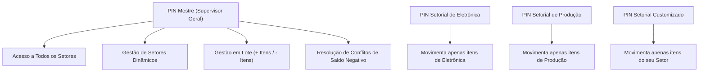

<div align="center">
  
  <h1>Estoque Luxpryme</h1>
  <p><strong>Sistema Industrial de Controle de Almoxarifado e Estoque de Alta Precisão</strong></p>
  <p>
    <b>Versão 1.2.0</b> • <b>Offline-First (0ms)</b> • <b>Setores Industriais</b> • <b>Rastreabilidade por PIN</b>
  </p>
  <p>
    Desenvolvido e Administrado por <b>Tomas Pereyra</b> para <b>Luxpryme Indústria Eletrônica</b>
  </p>

  <p>
    
    
    
    
  </p>
</div>

---

## 🎨 Identidade Visual Corporativa

O **Estoque Luxpryme** adota uma identidade visual sóbria, funcional e moderna, desenhada especificamente para ambientes industriais, galpões fabris e laboratórios eletrônicos:

* **Símbolo Oficial:** Quadrado com cantos arredondados em **Azul Luxpryme** (`#1976D2`) destacando a letra **"L"** em **branco puro** com proporção geométrica harmoniosa e excelente legibilidade.
* **Paleta de Cores Setorial:**
  * 🔵 **Azul Luxpryme (`#1976D2`):** Setor de Laboratório Eletrônico (SMD, PTH, PCBs, ICs) e cor mestra do sistema.
  * 🟢 **Verde Produção (`#16A34A`):** Setor de Produção Industrial (montagem mecânica, chicotes, baterias e luminárias).
  * ⚪ **Cinza Slate (`#64748B`):** Setor Outros (almoxarifado geral, manutenção fabril, civil e insumos de apoio).
  * 🟣 **Cores Customizadas:** Novos setores criados pela supervisão podem receber cores exclusivas (ex: Roxo para *Embalamento*, Laranja para *Preparação*).
* **Feedback de Estoque:**
  * 🟢 **Verde (`#16A34A`):** Estoque Saudável / Normal.
  * 🟡 **Âmbar (`#D97706`):** Estoque Baixo (próximo ao ponto de pedido).
  * 🔴 **Vermelho (`#DC2626`):** Estoque Esgotado / Alerta de Saldo Negativo.
* **Tipografia:** Família *Inter* para interface de alta densidade e *Montserrat* no símbolo corporativo.

---

## 🏭 Arquitetura por Setores da Fábrica

Para suportar grandes volumes e evitar interferências entre áreas produtivas, o estoque é estruturado em **Setores**:



* **Multi-Vínculo:** Um produto pode pertencer a mais de um setor simultaneamente (ex: um chicote ou bateria usado tanto no laboratório eletrônico quanto na linha de montagem final).
* **Setores Dinâmicos:** Novos setores industriais (ex: *Preparação de Fios*, *Embalamento*, *Expedição*) podem ser criados a qualquer momento pelo supervisor com PIN Mestre diretamente pelo app.

---

## 🚀 Principais Recursos da Versão 1.2.0

### 1. Tecnologia 100% Offline-First (Inicialização em 0ms)
* **Baixa Única em Disco:** O catálogo completo (> 5.420 produtos) é gravado no armazenamento local do aparelho.
* **Abertura Imediata:** Ao reabrir o aplicativo, não há telas de carregamento — o estoque abre instantaneamente em **0 milissegundos**, pronto para consulta e movimentação mesmo sem sinal de Wi-Fi ou em modo avião.
* **Sincronização Silenciosa em Segundo Plano:** Movimentações realizadas offline são enfileiradas e enviadas para a nuvem automaticamente assim que houver conexão com a internet.

### 2. Detecção e Resolução de Conflitos de Estoque
* Se dois operadores retirarem peças do mesmo componente em aparelhos desconectados e o saldo resultante ficar negativo ao sincronizar, o sistema emite um alerta destacado com 4 opções de regularização:
  1. **Zerar Saldo (0 un)** com registro de auditoria.
  2. **Digitar Saldo Real** contado fisicamente na prateleira/gaveteiro.
  3. **Estornar Déficit** devolvendo as peças ao ponto de equilíbrio.
  4. **Dispensar Notificação**.

### 3. Gestão em Lote de Setores (`+ Itens` e `- Itens`)
* **`+ Itens`:** Ferramenta com busca inteligente e contador dinâmico (círculo azul) para adicionar múltiplos produtos a um setor. A busca limpa automaticamente a cada seleção para agilizar o fluxo contínuo.
* **`- Itens`:** Filtra apenas os itens do setor para desvincular em lote com segurança.

### 4. Carrinho de Separação com Observação Técnica
* Separação de kits de componentes para ordens de produção ou entrada de notas de fornecedores.
* Suporta **anotação opcional** direta no carrinho (ex: *"OS #840 - Linha 2 de Luminárias"*).
* Baixa conjunta protegida por autenticação de **PIN de 4 dígitos**.

### 5. Busca Multi-Termo Desordenada
* Localiza qualquer produto mesmo se as palavras forem digitadas fora de ordem (ex: `farol placa 16` encontra `MONTAGEM PLACA ELETRONICA FAROL 16 LEDS`).
* Busca instantânea por Código Interno e Part Number do Fabricante.

### 6. Interface Adaptativa (Mobile vs Desktop)
* **Mobile (Android):** Menu superior limpo com busca expansível via lupa, barra de setores compacta, acesso às famílias técnicas via toque longo no chip do setor e menu circular de ações flutuante no canto inferior direito.
* **Desktop (Windows):** Barra de busca ampla centralizada, atalhos de administração no cabeçalho e menu de ferramentas rápidas.

---

## 💻 Stack Tecnológica

| Camada | Tecnologia | Detalhes |
| :--- | :--- | :--- |
| **Frontend** | Flutter 3.47+ / Dart 3 | Suporte nativo multiplataforma (Windows Desktop e Android) |
| **Banco de Dados Cloud** | Supabase (PostgreSQL) | Regras RLS, triggers de integridade e publicação Realtime |
| **Cache Local** | LocalCacheService (Disco) | Armazenamento JSON local persistente e fila offline |
| **Tipografia** | Google Fonts (Inter / Montserrat) | Ergonomia visual de alta densidade de dados |

---

## 📦 Como Compilar e Exportar

### 🤖 Gerar APK para Android
```bash
flutter build apk --release
```
* O arquivo final gerado estará em:
  `build/app/outputs/flutter-apk/app-release.apk`

### 💻 Gerar Executável para Windows
```bash
flutter build windows --release
```
* O executável nativo e as DLLs estarão em:
  `build/windows/x64/runner/Release/luxpryme_stock.exe`

---

## 👥 Autoria e Administração

* **Desenvolvedor e Administrador Geral:** Tomas Pereyra (`tomibr20@gmail.com`)
* **Empresa:** Luxpryme Indústria Eletrônica

---

## 📄 Licença

Este software é distribuído sob licença **Proprietária e Confidencial**. Todos os direitos reservados à **Tomas Pereyra** e **Luxpryme Indústria Eletrônica**. Consulte o arquivo [LICENSE](./LICENSE) para obter detalhes completos sobre os termos de uso.
