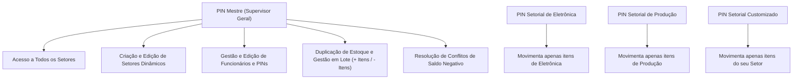

<div align="center">
  
  <h1>Estoque Luxpryme</h1>
  <p><strong>Sistema Industrial de Controle de Almoxarifado e Estoque de Alta Precisão</strong></p>
  <p>
    <b>Versão 1.5.0</b> • <b>Local-First Zero-Latency (0ms)</b> • <b>100% Offline-First</b> • <b>Duplicar Estoque por Setor</b> • <b>Unidades (Un, Peso, Metro, Volume)</b> • <b>Relatórios PDF/CSV</b>
  </p>
  <p>
    Desenvolvido e Administrado por <b>Tomas Pereyra</b> para <b>Luxpryme Indústria Eletrônica</b>
  </p>

  <p>
    
    
    
    
    
    
  </p>
</div>

---

## 🎨 Identidade Visual Corporativa

O **Estoque Luxpryme** adota uma identidade visual sóbria, funcional e moderna, desenhada especificamente para ambientes industriais, galpões fabris e laboratórios eletrônicos:

* **Símbolo Oficial:** Quadrado com cantos arredondados em **Azul Luxpryme** (`#1976D2`) destacando a letra **"L"** em **branco puro** com proporção geométrica harmoniosa e excelente legibilidade.
* **Paleta de Cores Setorial:**
  * 🔵 **Azul Luxpryme (`#1976D2`):** Setor de Laboratório Eletrônico (SMD, PTH, PCBs, ICs) e cor mestra do sistema.
  * 🟢 **Verde Produção (`#16A34A`):** Setor de Produção Industrial (montagem mecânica, chicotes, baterias e luminárias).
  * ⚪ **Cinza Slate (`#64748B`):** Setor Outros (almoxarifado geral, manutenção fabril, civil e insumos de apoio).
  * 🟣 **Cores Customizadas:** Novos setores criados pela supervisão podem receber cores exclusivas (ex: Roxo para *Embalamento*, Laranja para *Preparação*).
* **Feedback de Estoque:**
  * 🟢 **Verde (`#16A34A`):** Estoque Saudável / Normal.
  * 🟡 **Âmbar (`#D97706`):** Estoque Baixo (próximo ao ponto de pedido).
  * 🔴 **Vermelho (`#DC2626`):** Estoque Esgotado / Alerta de Saldo Negativo.
* **Tipografia:** Família *Inter* para interface de alta densidade e *Montserrat* no símbolo corporativo.

---

## 🏭 Arquitetura por Setores da Fábrica

Para suportar grandes volumes e evitar interferências entre áreas produtivas, o estoque é estruturado em **Setores**:



* **Estoque Compartilhado vs Estoques Separados por Setor (`Duplicar estoque`):**
  * **Estoque Compartilhado:** Um produto pode ter mais de um setor marcado no mesmo registro quando é armazenado em um local e utilizado por mais de um setor.
  * **Estoques Separados por Setor:** Pelo botão **`Duplicar estoque`** no produto (ou pelo `+ Itens`), é possível criar um segundo estoque independente do mesmo produto em outro setor. Na aba **`Todas`**, os diferentes estoques do mesmo produto são consolidados em **1 único card** com a **soma total** e o detalhe de quanto há em cada setor.
* **Setores Dinâmicos Editáveis:** Novos setores industriais podem ser criados, **renomeados** ou editados a qualquer momento pelo supervisor com PIN Mestre diretamente pelo app.

---

## 🚀 Principais Recursos da Versão 1.5.0

### 1. Arquitetura Local-First Zero-Latency (0ms) & Sincronização Completa
* **Resposta Imediata na Interface:** Todas as operações de cadastrar novo item, editar produto, duplicar estoque, arquivar/desarquivar, trocar categorias em lote, renomear setores, editar funcionários/PINs, ajuste unitário (`+1`/`-1`) ou finalização de carrinho acontecem **instantaneamente na memória e no cache local** em **0 milissegundos**.
* **Sincronização Completa Multi-Tabela (`syncAllWithSupabase`):** O botão de atualização manual descarrega a fila offline com segurança e baixa simultaneamente produtos, categorias, setores, PINs de operadores e histórico antes de confirmar a sincronização na tela.

### 2. Duplicar Estoque em Outro Setor e Soma Consolidada na Aba "Todas"
* **Botão `Duplicar estoque`:** Cria um estoque separado e independente do mesmo produto em outro setor da fábrica, permitindo informar a quantidade inicial e a localização física naquele setor.
* **Card Consolidado na Aba `Todas`:** Na aba `Todas` (e nos relatórios de *Todos os Setores*), os diferentes estoques do mesmo produto são somados em **1 único card** exibindo a **Soma Total dos Estoques** (ex: `40 un`) e os chips detalhando quanto há em cada setor (ex: `Eletrônica: 25 un` • `Produção: 15 un`).

### 3. Escolha da Forma de Contagem / Unidade de Medida
* Ao editar ou cadastrar cada produto, é possível escolher como contá-lo:
  * **Unidade (`un`)**
  * **Peso:** **Quilogramas (`kg`)** ou **Gramas (`g`)**
  * **Metro:** **Metros (`m`)** ou **Centímetros (`cm`)**
  * **Volume:** **Litros (`L`)** ou **Mililitros (`mL`)**
* A unidade escolhida é exibida nos cards, no carrinho, nos diálogos de movimentação e nos relatórios PDF/CSV, sincronizando com o Supabase.

### 4. Categorias Filtradas por Setor, Troca em Lote, Renomeação e Exclusão Livre
* **Filtro Contextual por Setor:** O menu e a barra de categorias exibem exclusivamente as categorias vinculadas ao setor atualmente selecionado.
* **Trocar Categoria de Produtos em Lote (`⇄ Trocar Produtos de Categoria`):** Permite selecionar múltiplos produtos dentro de uma categoria e transferi-los para outra categoria em 1 clique.
* **Edição de Nome em Cascata (0ms) e Exclusão Livre:** Permite renomear qualquer categoria ou excluí-la mesmo que existam produtos vinculados (desvinculando os produtos automaticamente sem apagá-los).

### 5. Busca Inteligente com Espera de Digitação (*Debounce*) e Melhor Coincidência (`O(N)`)
* **Fluidez Total ao Digitar:** O buscador aguarda o usuário terminar de escrever (380ms ou tecla `Enter`) antes de filtrar e ordenar os > 5.420 produtos, eliminando saltos ou travamentos durante a digitação.
* **Pré-cálculo `O(N)` de Relevância:** Prioriza no topo dos resultados os produtos com correspondência exata da frase buscada, pares de palavras consecutivas e validação de siglas técnicas curtas (`ac`, `dc`, `ir`, `uv`) por limite exato de palavra.

### 6. Exportação Direta de Relatórios como Arquivo PDF e CSV (Setor, Arquivados e Histórico)
* **Botão `Exportar PDF`:** Salva o arquivo `.pdf` A4 diretamente no computador através da janela nativa **"Salvar como..."** do Windows (e menu nativo de salvamento/compartilhamento no Android), abrindo o PDF gerado automaticamente.
* **Botão `Imprimir`:** Mantido separadamente para envio direto a impressoras físicas.
* **Ordenação Configurável:** Ordenação numérica natural **Por Código Interno** ou **Alfabética por Nome (A - Z)**, trazendo **Código Interno**, **Nome do Produto** e **Quantidade no Estoque**.

### 7. Produtos Arquivados Divididos por Setor (`Arquivados`)
* Seção exclusiva para produtos fora de uso que ainda possuem saldo físico em estoque, divididos por setor e com edição completa de quantidade, unidade, setor e categorias.

---

## 💻 Stack Tecnológica

| Camada | Tecnologia | Detalhes |
| :--- | :--- | :--- |
| **Frontend** | Flutter 3.47+ / Dart 3 | Suporte nativo multiplataforma (Windows Desktop e Android) |
| **Arquitetura** | Local-First Zero-Latency | Operações em 0ms na memória/disco + background workers |
| **Banco de Dados Cloud** | Supabase (PostgreSQL 15) | Regras RLS, triggers de integridade, UUIDs nativos e sincronização multi-tabela |
| **Relatórios & Exportação** | PDF (A4 Direto) & CSV (UTF-8 BOM) | Exportação direta de arquivos `.pdf` e `.csv` para setores, arquivados e histórico |
| **Cache Local** | LocalCacheService (Disco) | Armazenamento JSON local persistente para produtos, categorias, setores, PINs e fila offline |
| **Tipografia** | Google Fonts (Inter / Montserrat) | Ergonomia visual de alta densidade de dados |
| **Testes Automatizados** | Flutter Test (51 testes) | Validação de busca `O(N)`, duplicação de estoque, unidades, arquivados, relatórios, categorias e RBAC |

---

## 📚 Documentação e Recursos

* 📘 **[Manual de Uso Completo (Markdown)](./MANUAL_DE_USO.md):** Guia detalhado passo a passo de todas as telas e operações do sistema na versão 1.5.0.
* 📑 **[Manual de Uso Oficial em Word (.docx)](./Manual_de_Uso_Estoque_Luxpryme.docx):** Versão formatada pronta para impressão e distribuição aos operadores (Versão 1.5.0).
* 🚀 **[Estudo de Caso Técnico / LinkedIn](./CASE_STUDY_LINKEDIN.md):** Case study de engenharia de software com desafios, decisões arquiteturais e métricas de impacto.

---

## 📦 Como Compilar e Exportar

### 🤖 Gerar APK para Android
```bash
flutter build apk --release --no-tree-shake-icons
```
* O arquivo final gerado estará em:
  `build/app/outputs/flutter-apk/app-release.apk`

### 💻 Gerar Executável para Windows
```bash
flutter build windows --release --no-tree-shake-icons
```
* O executável nativo e as DLLs estarão em:
  `build/windows/x64/runner/Release/luxpryme_stock.exe`

---

## 👥 Autoria e Administração

* **Desenvolvedor e Administrador Geral:** Tomas Pereyra (`tomibr20@gmail.com`)
* **Empresa:** Luxpryme Indústria Eletrônica

---

## 📄 Licença

Este software é distribuído sob licença **Proprietária e Confidencial**. Todos os direitos reservados à **Tomas Pereyra** e **Luxpryme Indústria Eletrônica**. Consulte o arquivo [LICENSE](./LICENSE) para obter detalhes completos sobre os termos de uso.
